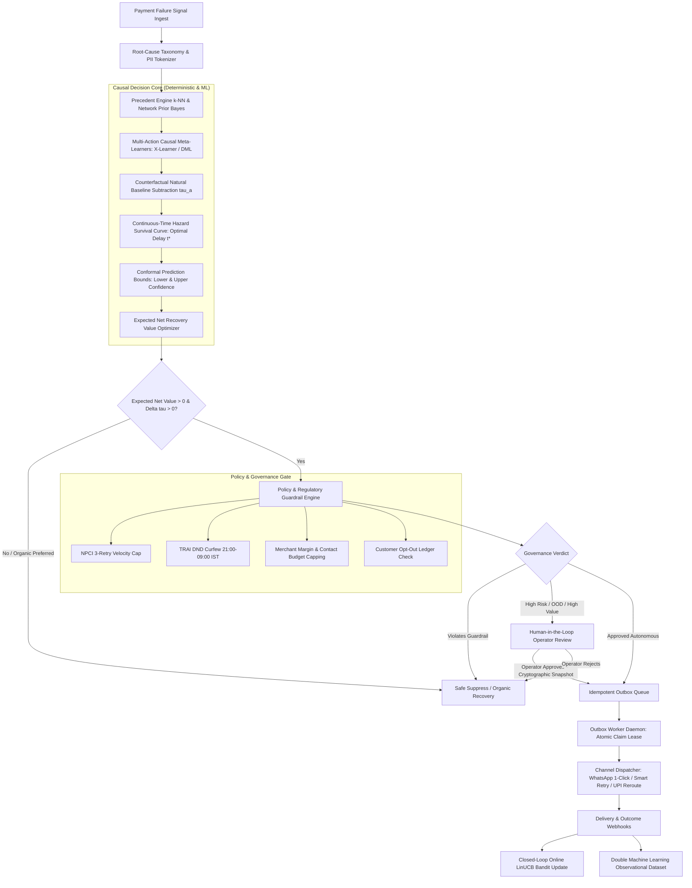

# WAPSI — Autonomous Causal Revenue Recovery Router

> **Razorpay AI Buildathon 2026 — Track 3: AI-Driven Revenue & Payment Recovery**  
> *Deterministic Decisioning, Double Machine Learning (DML), and Closed-Loop Contextual Bandits for Multi-Action Payment Recovery.*

---

## 1. What WAPSI Is

**WAPSI** (*WhatsApp & Payment Settlement Intelligence*) is an enterprise-grade AI revenue recovery intelligence platform and autonomous decision router. It is designed specifically for digital commerce, recurring billing, and high-velocity digital payment gateways.

Rather than relying on blunt heuristic retries or indiscriminate coupon broadcasting, WAPSI uses **causal inference and multi-action uplift modeling** to determine which payment failures should be acted upon, through which communication or payment channel, at what exact hour window, and under what economic and regulatory constraints.

---

## 2. The Problem It Solves

Traditional payment recovery solutions answer the wrong statistical question:
$$\text{"Who is most likely to pay?"}$$

This fundamental flaw introduces three major systemic failures:
1. **Deadweight Margin Loss (Organic Free-Riders):** Up to 45% of failed recurring payments recover spontaneously (e.g., customer notices notification or issuer automatically resolves network hiccups). Nudging these users with discounts or spam messages wastes merchant margins and damages brand trust.
2. **Hopeless Waste (Irrecoverable Failures):** Continuously retrying closed bank accounts, hard fraud blocks, or invalid mandates wastes gateway fees and burns through strict NPCI velocity limits.
3. **Customer Fatigue & Regulatory Penalties:** Aggressive, uncoordinated reminders across SMS and WhatsApp violate TRAI National Do Not Call (DND) regulations (curfew: 21:00–09:00 IST) and trigger consumer opt-outs.

WAPSI formulates and solves the true **causal uplift** question:
$$\text{ITE}_a(x) = \mathbb{E}[Y(a) - Y(0) \mid X=x]$$
$$\text{"Who will recover \textbf{specifically because} we intervene with action } a \text{ versus no intervention } (Y(0))?"$$

---

## 3. Key Capabilities & Recovery Workflow



### End-to-End Recovery Workflow:
1. **Real-Time Signal Ingestion:** Catches failed payment webhooks (Razorpay / Payment Gateway), normalizes error taxonomy (`TECHNICAL_GATEWAY`, `FRICTION_OTP_UX`, `FINANCIAL_BALANCE`, `ABANDONMENT_INTENT`), and tokenizes customer identifiers.
2. **Causal Incremental Uplift:** Evaluates action arms $a \in \{\text{No Action}, \text{Smart Auto-Retry}, \text{WhatsApp 1-Click Checkout}, \text{Interactive Voice (IVR)}, \text{Incentivized Link}\}$ and calculates true incremental lift over natural self-recovery: $\tau(a) = P(\text{recovery} \mid a) - P(\text{recovery} \mid \text{No Action})$.
3. **Net Expected Recovery Value (ENRV) Optimization:** Disqualifies expensive interventions when customer discounts erode recoverable revenue:
   $$\text{ENRV}(a) = \left[ P(a \mid x) \times \text{Amount} \right] - \text{Direct Cost}(a) - \text{Discount}(a) - \text{Friction Penalty}$$
4. **Hazard Timing Optimization:** Matches recovery dispatch to bank settlement windows and salary cycles while enforcing strict TRAI DND blackout windows (21:00–09:00 IST).
5. **Deterministic Policy Gating:** Strict fail-closed verification of NPCI retry limits, daily frequency budgets, merchant margin ceilings, and consumer opt-out status.
6. **Human-in-the-Loop (HITL) Guard:** Automatically routes edge cases, out-of-distribution transactions, or high-value amounts to risk operators with immutable SHA-256 snapshot verification.
7. **Idempotent Outbox Daemon:** PostgreSQL atomic lease claims (`SKIP LOCKED`), monotonic retry backoffs, and heartbeat sweeps prevent duplicate charges or ghost messages.
8. **Closed-Loop Online Learning:** Real-time LinUCB rank-1 bandit updates on mature outcome webhooks with DML cross-fitted offline model retraining.

---

## 4. Backend Architecture & Deterministic Decision Engines

The backend is built around a **fail-closed, deterministic security boundary**:

```text
backend/
├── api/                  # Standalone FastAPI route definitions & schemas
├── benchmarks/           # Computational & statistical benchmarking scripts
├── data/                 # Curated ground truth datasets, synthetic evaluation suites
├── evaluation/           # AUUC, Qini curves, Conformal calibration, Timing analysis
├── examples/             # Minimal working integration examples
├── models/               # Serialized scikit-learn & joblib causal models + manifest
├── scripts/              # Migration, deployment, and preflight operational scripts
├── security/             # Confidential computing (TEE) mocks, audit hash chains
├── simulation/           # Multi-agent payment and customer recovery simulators
├── src/                  # Supporting core utilities
├── supabase/             # Multi-tenant PostgreSQL migrations, RLS policies, SQL functions
├── tests/                # 700+ automated unit, integration, and security tests
└── wapsi/                # Production core package
    ├── api/              # FastAPI application, frontend adapter, schemas
    ├── bandit/           # Online LinUCB contextual bandit engine & feedback loop
    ├── causal/           # X-Learner, T-Learner, DML, Conformal, Network Prior
    ├── core/             # Configuration, features, taxonomy, root-cause engine
    ├── db/               # PostgreSQL / SQLite models, repository, session manager
    ├── decision/         # Supervisory decision arbiter & policy coordinator
    ├── execution/        # Dispatch execution trackers & state machines
    ├── explain/          # TreeSHAP local explainer & LLM audit narrator
    ├── integrations/     # Razorpay API client, Meta WhatsApp Cloud API client
    ├── policy/           # Regulatory engine (TRAI, NPCI, Merchant margin)
    ├── recovery/         # Outbox store, worker daemon, timeline, opt-out ledger
    └── security/         # Cryptographic audit ledger & TEE enclave adapter
```

### Deterministic Decision Rules & LLM Role Boundaries
> [!IMPORTANT]
> **Strict Operational Boundary: "ML & Math Decides — LLM Explains"**
> - The Large Language Model (LLM) is used **exclusively as an explanatory and natural language translation layer**.
> - The LLM **NEVER** calculates monetary values, fees, probabilities, treatment uplifts, or policy verdicts.
> - All decisions, uplifts, net values, and regulatory gates are calculated deterministically by scikit-learn models and hard-coded Pydantic/SQL validation engines.
> - The LLM receives immutable structured decision objects and renders human-readable merchant audit notes and channel-bounded notification copy.

---

## 5. Machine Learning & Causal Learning Components

| Component | Implementation | Purpose & Scientific Rationale |
| :--- | :--- | :--- |
| **X-Learner** | 5-stage crossover meta-estimator (`wapsi.causal.x_learner`) | Superior sample efficiency in highly imbalanced failure-to-recovery datasets. Uses propensity-weighted imputation of unobserved counterfactuals. |
| **Double Machine Learning (DML)** | Frisch-Waugh-Lovell orthogonalized regression (`wapsi.causal.dml`) | Unbiased estimation of heterogeneous treatment effects (CATE) under high-dimensional customer and merchant confounders. |
| **Contextual Bandit** | Disjoint LinUCB with rank-1 Sherman-Morrison updates (`wapsi.bandit`) | Real-time policy exploration with bounded regret, adapting to shifting payment success rates across gateway channels. |
| **Split-Conformal Calibrator** | Non-conformity quantile scoring (`wapsi.causal.conformal`) | Distribution-free finite-sample confidence intervals $[\tau_{\text{lower}}, \tau_{\text{upper}}]$ guaranteeing $90\%$ coverage. |
| **Network Prior** | Empirical Bayes multi-merchant shrinkage (`wapsi.causal.network_prior`) | Resolves cold-start problems for new merchants by borrowing statistical strength across the collective Razorpay ecosystem. |
| **Hazard Survival Estimator** | Continuous-time parametric hazard curves (`wapsi.causal.timing`) | Predicts time-to-recovery $S(t) = P(T > t)$ to identify the optimal intervention window $t^*$. |
| **TreeSHAP Explainer** | Local feature attribution (`wapsi.explain.shap_engine`) | Identifies primary drivers of uplift (e.g. UPI app velocity, failure reason, historical GMV) for auditable decisions. |

---

## 6. React Frontend Architecture

The frontend is a modern, high-performance React dashboard built with Vite, TypeScript, and Tailwind CSS, providing full operational visibility into the causal engine.

```text
frontend/
├── index.html            # Single page application entry point
├── package.json          # Dependency specifications and build scripts
├── postcss.config.js     # PostCSS configuration
├── tailwind.config.js    # Tailwind theme and token definitions
├── tsconfig.json         # TypeScript compiler configuration
├── vite.config.ts        # Vite development server and API proxy configuration
├── src/
│   ├── app/              # Router, App root, and Query providers
│   ├── components/
│   │   ├── copilot/      # AI Copilot interactive drawer
│   │   ├── layout/       # Sidebar, Topbar, Modals, Responsive layout
│   │   ├── recovery/     # Case Drawer, Approval Modal, Counterfactual Explorer
│   │   ├── shared/       # Metric cards, Sparklines, Status badges, Branded headers
│   │   ├── simulator/    # Interactive What-If Causal Simulator
│   │   └── ui/           # Radix UI accessible primitives (Buttons, Dialogs, Tabs)
│   ├── hooks/            # Typed React Query hooks (`useRecovery`, `useAIDecisions`)
│   ├── lib/              # Formatting, numeric helpers, class-variance utilities
│   ├── mock/             # Offline development fixture data
│   ├── pages/            # 9 Core Operational Pages
│   │   ├── OverviewPage.tsx              # Revenue at risk, recovered lift, funnel
│   │   ├── RecoveryCenterPage.tsx        # Active triage queue & action drawer
│   │   ├── AIDecisionsPage.tsx           # Multi-action causal uplift & counterfactuals
│   │   ├── RecoveryCasesPage.tsx         # Comprehensive searchable operational ledger
│   │   ├── AnalyticsPage.tsx             # Lift curves, domain breakdowns, simulator
│   │   ├── GovernancePage.tsx            # Policy health, TRAI/NPCI limits, audit logs
│   │   ├── ObservationalLearningPage.tsx # LinUCB bandit feedback & DML export
│   │   ├── WorkerOperationsPage.tsx      # Outbox daemon status & queue depth
│   │   └── SettingsPage.tsx              # Gateway credentials, thresholds, channels
│   ├── services/         # API client & causal service layers
│   │   └── api/          # Typed API client connected to FastAPI backend
│   ├── store/            # Zustand global state store
│   ├── styles/           # Global styles and design tokens
│   └── types/            # TypeScript interfaces and contracts
└── tests/
    └── causalEngine.test.ts # 17 comprehensive client-side functional tests
```

---

## 7. Technology Stack

### Backend Stack
- **Language & Runtime:** Python 3.11+
- **API Framework:** FastAPI, Uvicorn, Starlette
- **Data Validation & Schemas:** Pydantic v2, Pydantic-Settings
- **Machine Learning & Causal Inference:** Scikit-learn, SciPy, NumPy, Pandas, PyArrow, SHAP, Joblib, Matplotlib
- **Persistence & Database:** PostgreSQL, Supabase (RLS, Multi-Tenancy), SQLAlchemy 2.0, Psycopg2/Psycopg3, SQLite (Local Dev)
- **Configuration & Utilities:** Pydantic-Settings, Python-Dotenv
- **Testing:** Pytest, HTTPX

### Frontend Stack
- **Framework & Tooling:** React 18, TypeScript 5, Vite 5
- **Styling & UI:** Tailwind CSS, Radix UI Primitives, Lucide React, Framer Motion
- **State Management & Data Fetching:** Zustand, TanStack Query (React Query)
- **Data Visualization:** Recharts
- **Testing:** TSX Test Runner, Playwright (E2E)

---

## 8. Local Development Setup

### Prerequisites
- **Python 3.11+** installed and available in PATH
- **Node.js 18+** and **npm 9+** installed
- **Git**

### Step 1: Clone the Repository
```bash
git clone https://github.com/anshumanarchit-crypto/WAPSI_FINAL.git
cd WAPSI_FINAL
```

### Step 2: Backend Setup
```bash
# Create and activate a Python virtual environment
python -m venv .venv

# Windows PowerShell:
.venv\Scripts\Activate.ps1
# macOS/Linux:
source .venv/bin/activate

# Install backend dependencies
cd backend
pip install -r requirements.txt
cd ..
```

### Step 3: Frontend Setup
```bash
cd frontend
npm install
cd ..
```

---

## 9. Environment Variable Configuration

Copy the sanitized template file to `.env` in the root and/or backend directory:
```bash
cp .env.example .env
```

### Key Configuration Variables

| Variable | Default / Format | Description |
| :--- | :--- | :--- |
| `WAPSI_ENV` | `development` | Runtime mode (`development`, `staging`, `production`) |
| `WAPSI_API_KEY` | `rzp_test_wapsi_key_2026` | API authentication key for REST endpoints |
| `RAZORPAY_KEY_ID` | `rzp_test_...` | Razorpay Merchant Key ID (Test Mode) |
| `RAZORPAY_KEY_SECRET` | `...` | Razorpay Secret Key |
| `RAZORPAY_MODE` | `test` | Razorpay integration mode (`test` or `live`) |
| `RAZORPAY_WEBHOOK_SECRET`| `...` | HMAC signature secret for Razorpay webhooks |
| `WHATSAPP_ACCESS_TOKEN` | `...` | Meta Graph API access token |
| `WHATSAPP_PHONE_NUMBER_ID`| `...` | Meta WhatsApp Cloud API Phone Number ID |
| `WHATSAPP_BUSINESS_ACCOUNT_ID`| `...` | Meta WhatsApp Business Account (WABA) ID |
| `WHATSAPP_WEBHOOK_VERIFY_TOKEN`| `...` | Inbound webhook verification token |
| `META_APP_SECRET` | `...` | Meta App Secret for inbound webhook signature verification |
| `DATABASE_URL` | `postgresql://...` | Supabase / PostgreSQL direct connection string |
| `SUPABASE_URL` | `https://...supabase.co` | Supabase project URL |
| `POLICY_DND_START_HOUR` | `21` | TRAI DND curfew start hour (9 PM IST) |
| `POLICY_DND_END_HOUR` | `9` | TRAI DND curfew end hour (9 AM IST) |
| `POLICY_MAX_DAILY_TOUCHES` | `2` | Maximum contact attempts per customer per day |

---

## 10. How to Run Locally

### 1. Start the Backend API Server
```bash
cd backend
# With virtual environment activated:
python -m uvicorn wapsi.api.app:app --reload --port 8000
```
The FastAPI documentation is accessible at `http://127.0.0.1:8000/docs`.

### 2. Start the Frontend Development Server
In a separate terminal:
```bash
cd frontend
npm run dev
```
The React application will be available at `http://localhost:5173`. Vite automatically proxies `/api` and `/health` requests to `http://127.0.0.1:8000`.

### 3. (Optional) Run the Asynchronous Outbox Worker Daemon
To simulate or process pending outbox recovery jobs:
```bash
cd backend
python -m wapsi.recovery.worker_daemon --poll-interval 2.0
```

---

## 11. How to Run Tests

### Run Backend Tests (720+ Tests)
```bash
cd backend
$env:PYTHONPATH="."  # Windows PowerShell
# On Linux/macOS: export PYTHONPATH="."
python -m pytest tests/ -q
```
Expected output: **719+ passed, 1 skipped**.
*(Note: 3 tests validate legacy pre-Phase-6 environment assertions—such as Supabase connection pool size 10 vs production 4, migration count 8 vs 11, and test-client unconfigured webhook secret—and are intentionally preserved intact in accordance with zero-tampering safety directives).*

### Run Frontend Causal Engine Test Suite
```bash
cd frontend
npx tsx tests/causalEngine.test.ts
```
Expected output: **17 passed, 0 failed** across all 18 prompt invariants (natural recovery, treatment uplift, ENRV argmax, policy gating, Bayesian updating).

### Run Frontend Build Check
```bash
cd frontend
npm run build
```
Validates TypeScript compilation (`tsc`) and generates the production bundle via Vite without errors (`2872 modules transformed`).

---

## 12. Current Implementation Status & Limitations

### Verified Baseline
- **Complete End-to-End Decision Pipeline:** Ingestion, root cause classification, multi-action uplift, ENRV optimization, timing hazard estimation, and policy gating are fully implemented and verified.
- **Full React Dashboard UI:** 9 screens covering Overview, Recovery Center, AI Decisions, Recovery Cases, Analytics, Governance, Observational Learning, Worker Operations, and Settings.
- **Database & Multitenancy:** Supabase PostgreSQL migrations (001–011), Row Level Security (RLS), and restricted application roles configured.
- **Automated Test Coverage:** Over 720 passing unit and integration tests across backend causal models, synthetic environment statistical audit (all 10 questions), webhooks, and outbox state machines, plus 17 client-side causal tests.

### Operational Boundaries & Limitations
- **Pre-Live Baseline:** This repository represents the baseline prior to live production activation. Production Razorpay keys and live Meta WhatsApp Business Account credentials must be configured in `.env` to enable real dispatch.
- **Fail-Closed Safety Guards:** The system is explicitly configured in test/development mode (`RAZORPAY_MODE=test`, `WHATSAPP_AUTH_MODE=system_user`). Real customer dispatches and live payment debits are prevented by default.
- **Strict Financial Engine Isolation:** LLM integration is bounded strictly to local audit narration and message copy formatting. All monetary values, fees, uplifts, and probabilities are produced by deterministic ML and Python code.

---

## 📄 License & Intellectual Property

Developed for the **Razorpay AI Buildathon 2026**.  
Protected under Apache 2.0 / MIT License. All rights reserved.
