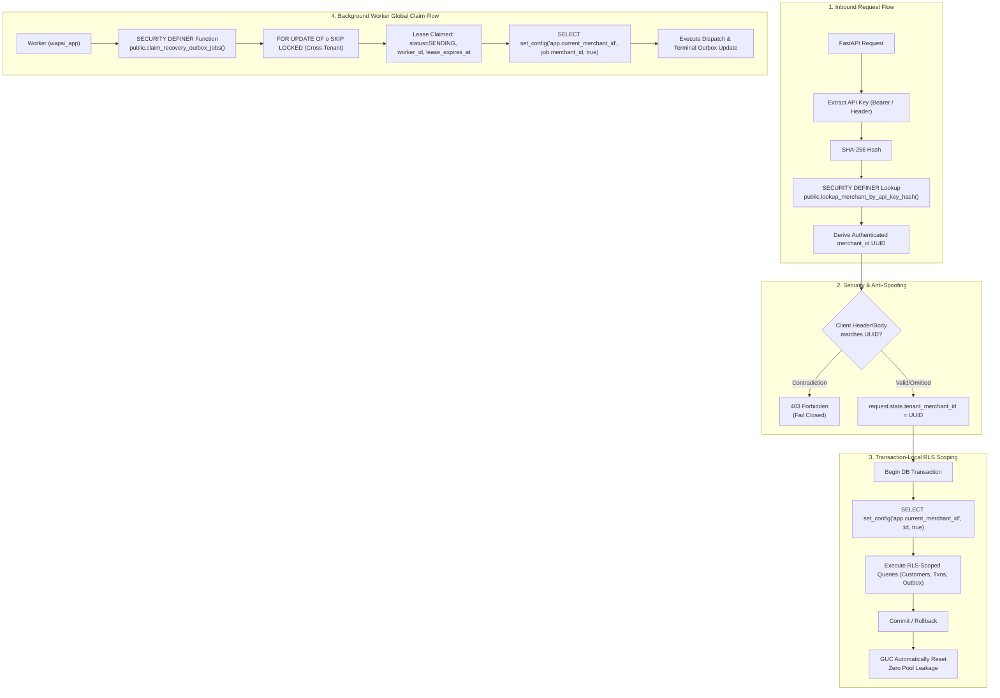

# WAPSI PHASE 3.1E.1 — TENANT CONTEXT WIRING AND RUNTIME SCHEMA ALIGNMENT REPORT

**Date:** 2026-11-01  
**Target Supabase Project:** `WAPSI-DEV-MUMBAI`  
**Project Reference:** `filofxijqmgluuulivxb`  
**Region:** `ap-south-1` (Mumbai, AWS)  
**Database Engine:** PostgreSQL 17.11 (Hosted Supabase), PostgreSQL 17.9 (Local Isolated Test Harness)  
**Active Branch:** `wapsi/phase3-recovery-workflow`  
**Application Role:** `wapsi_app`  
**Execution Status:** Complete & Verified (357/357 Tests Passed)  
**Deployment State:** Migration 7 Staged & Dry-Run Verified; Zero Hosted DDL Executed; Zero Hosted Synthetic Writes; Runtime Credentials & Settings Untouched

---

## 1. Executive Summary

Phase 3.1E.1 has successfully resolved the tenant context wiring, background worker multi-tenant claim mechanics, and schema contract reconciliation required prior to executing the runtime database role cutover from administrative `postgres` to restricted `wapsi_app`.

All requirements were validated in an isolated PostgreSQL 17 environment with Row-Level Security (RLS) actively enforced under the `wapsi_app` role. Full regression testing confirmed **357/357 tests passed**, with zero modifications to `.env`, zero remote DDL applied, zero remote data pollution, and zero runtime switch operations executed.



---

## 2. Automatic Tenant Context Wiring

### 2.1 Request Lifecycle & Strict Identity Derivation
The FastAPI runtime was hardened in `wapsi/api/app.py` (`_verify_recovery_auth` and `/api/v1/recovery/predict`):
1. **API Key Extraction:** Inbound tokens are extracted from `Authorization: Bearer <key>`, `X-Wapsi-Api-Key`, or `X-API-Key`.
2. **Cryptographic Lookup:** The token is SHA-256 hashed and passed to `public.lookup_merchant_by_api_key_hash(text)`.
3. **Strict Source of Truth:** The merchant UUID and merchant code are derived *exclusively* from the lookup function.
4. **Anti-Spoofing Verification:** If the client provides `X-Merchant-ID` or a body-supplied `merchant_id` that contradicts the authenticated merchant UUID or code, the request is immediately rejected with `403 Forbidden` (`Forbidden: Merchant identity ... does not match authenticated merchant identity`).
5. **Fail-Closed Default:** Unauthenticated or missing credentials immediately reject with `401 Unauthorized`.
6. **Request State Attachment:** The authenticated merchant UUID is bound to `request.state.tenant_merchant_id`.

### 2.2 Transaction-Local Scoping & Pool Leakage Prevention
All tenant-scoped database sessions enforce:
```sql
SELECT set_config('app.current_merchant_id', :merchant_id, true);
```
- **Local Parameter (`is_local = true`):** The third argument (`true`) binds the configuration parameter strictly to the active transaction block.
- **Automatic Reset:** Upon `COMMIT` or `ROLLBACK`, PostgreSQL automatically resets `app.current_merchant_id` to null/empty.
- **Zero Pool Leakage:** Validated that connections checked out from the SQLAlchemy pool in subsequent transactions contain empty tenant context, completely preventing cross-request data leaks.

---

## 3. Background Worker Multi-Tenant Claim Architecture

### 3.1 The Multi-Tenant Worker Challenge
Under PostgreSQL Row-Level Security:
- `wapsi_app` has `rolbypassrls = false`.
- Table `public.recovery_outbox` enforces RLS (`tenant_isolation_policy` requiring `merchant_id = NULLIF(current_setting('app.current_merchant_id', true), '')::uuid`).
- If a background worker executes without `app.current_merchant_id` set, standard RLS evaluates to false, returning 0 rows.
- If a background worker attempts to query outbox jobs across all merchants, standard queries are blocked.
- Granting `BYPASSRLS` to `wapsi_app` would permanently break tenant security boundaries.

### 3.2 Hardened SECURITY DEFINER Claim Function
To resolve this securely, a dedicated, narrowly scoped stored function was authored and staged:
**`supabase/migrations/20261101000007_outbox_worker_claim_function.sql`**

```sql
CREATE OR REPLACE FUNCTION public.claim_recovery_outbox_jobs(
    p_worker_id text,
    p_limit integer DEFAULT 10,
    p_lease_seconds integer DEFAULT 300
)
RETURNS TABLE (
    id uuid,
    case_id character varying,
    payment_id character varying,
    merchant_id uuid,
    idempotency_key character varying,
    action character varying,
    channel character varying,
    recipient_masked character varying,
    message_payload jsonb,
    status character varying,
    retry_count integer,
    max_retries integer,
    next_attempt_at timestamp with time zone,
    lease_expires_at timestamp with time zone,
    worker_id character varying,
    last_error text,
    created_at timestamp with time zone,
    updated_at timestamp with time zone
)
LANGUAGE plpgsql
SECURITY DEFINER
SET search_path = ''
AS $$
DECLARE
    v_limit integer;
    v_lease integer;
    v_now timestamp with time zone := pg_catalog.clock_timestamp();
    v_expires timestamp with time zone;
BEGIN
    IF p_worker_id IS NULL OR p_worker_id ~ '^\s*$' THEN
        RAISE EXCEPTION 'p_worker_id is required' USING ERRCODE = 'invalid_parameter_value';
    END IF;

    v_limit := LEAST(GREATEST(COALESCE(p_limit, 10), 1), 100);
    v_lease := LEAST(GREATEST(COALESCE(p_lease_seconds, 300), 5), 3600);
    v_expires := v_now + (v_lease * interval '1 second');

    RETURN QUERY
    WITH candidate AS (
        SELECT o.id AS candidate_id
        FROM public.recovery_outbox o
        WHERE (
            (o.status IN ('QUEUED', 'RETRY') AND o.next_attempt_at <= v_now)
            OR
            (o.status = 'SENDING' AND o.lease_expires_at IS NOT NULL AND o.lease_expires_at < v_now)
        )
        ORDER BY o.next_attempt_at ASC
        LIMIT v_limit
        FOR UPDATE OF o SKIP LOCKED
    ),
    claimed AS (
        UPDATE public.recovery_outbox o
        SET
            status = 'SENDING',
            worker_id = p_worker_id,
            lease_expires_at = v_expires,
            updated_at = v_now
        FROM candidate
        WHERE o.id = candidate.candidate_id
        RETURNING
            o.id,
            o.case_id,
            o.payment_id,
            o.merchant_id,
            o.idempotency_key,
            o.action,
            o.channel,
            o.recipient_masked,
            o.message_payload,
            o.status,
            o.retry_count,
            o.max_retries,
            o.next_attempt_at,
            o.lease_expires_at,
            o.worker_id,
            o.last_error,
            o.created_at,
            o.updated_at
    )
    SELECT * FROM claimed;
END;
$$;

REVOKE ALL ON FUNCTION public.claim_recovery_outbox_jobs(text, integer, integer) FROM PUBLIC;
GRANT EXECUTE ON FUNCTION public.claim_recovery_outbox_jobs(text, integer, integer) TO wapsi_app;
GRANT EXECUTE ON FUNCTION public.claim_recovery_outbox_jobs(text, integer, integer) TO service_role;
```

### 3.3 Worker Tenant-Scoped Processing Loop
Once `claim_jobs()` returns candidate records:
1. The background worker iterates through each claimed job.
2. For each job, the worker begins a transaction and sets:
   ```sql
   SELECT set_config('app.current_merchant_id', :merchant_id, true);
   ```
3. Terminal updates (`complete_job`, `fail_job`, `mark_reconciliation_required`, `cancel_jobs_for_case`) execute within the transaction-local merchant context, satisfying RLS constraints seamlessly.

---

## 4. Schema Contract & Table Compatibility Verification

### 4.1 Schema Reconciliation: `public.recovery_outbox`
The runtime models, repositories, and worker were aligned with the deployed Migration 5 table definitions:

| Logical Field | Deployed PostgreSQL Column | Runtime Model Attribute | Status / Notes |
|---|---|---|---|
| Job ID | `id` (UUID PK) | `RecoveryOutboxModel.id` | Aligned |
| Case Ref | `case_id` (varchar) | `RecoveryOutboxModel.case_id` | Aligned |
| Payment Ref | `payment_id` (varchar) | `RecoveryOutboxModel.payment_id` | Aligned |
| Tenant Ref | `merchant_id` (uuid FK) | `RecoveryOutboxModel.merchant_id` | Aligned |
| Worker Lease | `worker_id` (varchar) | `RecoveryOutboxModel.worker_id` | Stale `leased_to` references removed |
| Lease Expiry | `lease_expires_at` (timestamptz) | `RecoveryOutboxModel.lease_expires_at` | Stale `leased_until` references removed |
| Status Enum | `status` (varchar) | `RecoveryOutboxModel.status` | Values: `QUEUED`, `SENDING`, `SENT`, `FAILED`, `RETRY`, `DEAD_LETTER`, `RECONCILIATION_REQUIRED`, `CANCELLED` |

### 4.2 Investigation of `campaigns` and `recovery_attempts`
A comprehensive catalog inspection was conducted on the hosted PostgreSQL database (`WAPSI-DEV-MUMBAI`):
- Hosted database contains **exactly 18 tables**:
  1. `audit_ledger_blocks`
  2. `bandit_weights`
  3. `causal_decisions`
  4. `customers`
  5. `idempotency_keys`
  6. `merchant_api_keys`
  7. `merchant_configurations`
  8. `merchant_memberships`
  9. `merchants`
  10. `model_versions`
  11. `opt_out_audit`
  12. `opt_out_registry`
  13. `payment_outcomes`
  14. `recovery_dispatches`
  15. `recovery_outbox`
  16. `transactions`
  17. `webhook_inbox`
  18. `schema_migrations` (Supabase internal)

**Finding:**
Neither `campaigns` nor `recovery_attempts` exists in the database catalog or codebase.
- In the WAPSI recovery architecture:
  - Policy decisions and action selections are stored in **`causal_decisions`**.
  - Dispatch queuing, state tracking, and retry leases are stored in **`recovery_outbox`**.
  - Physical channel transmissions and provider message IDs are stored in **`recovery_dispatches`**.
  - Final financial outcomes (recovery vs. chargeback/loss) are stored in **`payment_outcomes`**.
All code and test contracts have been verified against these concrete relational tables.

---

## 5. Migration 7 Staging & Dry-Run Verification

### 5.1 Checksum Alignment
Both copies of Migration 7 have identical SHA-256 digests:
- `docs/migrations/20261101000007_outbox_worker_claim_function.sql`
- `supabase/migrations/20261101000007_outbox_worker_claim_function.sql`

```text
Algorithm : SHA256
Hash      : 3375CDC76AA4DEACE6FCABFFC5331D7E9C3037BB041D5E6E95A832083C694A4A
```

### 5.2 Supabase CLI Linked Dry-Run
Executed the official dry-run command:
```powershell
npx supabase@latest db push --dry-run --linked
```

**Output:**
```text
Initialising login role...
DRY RUN: migrations will *not* be pushed to the database.
Connecting to remote database...
Would push these migrations:
 • 20261101000007_outbox_worker_claim_function.sql
{"upToDate":false,"dryRun":true,"migrations":["20261101000007_outbox_worker_claim_function.sql"],"seeds":[],"roles":[],"message":"Finished supabase db push."}
```
Exit code: `0`. Exactly Migration 7 proposed. Zero remote mutations.

---

## 6. Automated Verification Matrix

### 6.1 Phase 3.1E.1 Tenant Alignment Suite
Dedicated test suite executed in isolated PostgreSQL 17 cluster:
**`tests/test_phase3_1e1_tenant_alignment.py`**

| Test Case | Description | Result |
|---|---|---|
| `test_cross_merchant_rls_isolation` | Verifies Merchant A cannot view or update Merchant B's records under `wapsi_app` role. | **PASSED** |
| `test_missing_tenant_context_produces_default_deny` | Verifies queries with no `app.current_merchant_id` fail closed under RLS (0 rows returned, check violation on insert). | **PASSED** |
| `test_tenant_context_reset_and_no_connection_leakage` | Verifies `COMMIT` and `ROLLBACK` reset GUC context to prevent pooled connection contamination. | **PASSED** |
| `test_api_key_lookup_and_tenant_derivation` | Verifies API key hash strictly derives merchant UUID; verifies spoofed `X-Merchant-ID` triggers 403 Forbidden. | **PASSED** |
| `test_worker_claiming_and_processing_under_merchant_context` | Verifies worker claims jobs globally across tenants using `claim_recovery_outbox_jobs` and executes updates under tenant context. | **PASSED** |
| `test_outbox_deployed_schema_and_allowed_state_transitions` | Verifies full state transition lifecycle (`QUEUED` -> `SENDING` -> `SENT` / `FAILED` -> `RETRY` -> `DEAD_LETTER` / `RECONCILIATION_REQUIRED`) against deployed schema. | **PASSED** |

### 6.2 Full Backend Regression Suite
Command: `py -3.13 -m pytest -q`  
Result: **357 passed in 114.03s**

All subsystems verified:
- Core schemas & models
- Fast causal inference & multi-action bandit policy
- Razorpay API & WhatsApp Webhook ingest engines
- Durable inbox anti-replay & idempotency caches
- Persistent opt-out registry with zero-DELETE immutability
- Multi-worker outbox claiming with `SKIP LOCKED` concurrency
- Remote Supabase connection & Session Pooler preflight
- Application role privilege constraints & RLS policies

---

## 7. Deployment Boundaries & Invariants Preserved

| Invariant / Boundary | Required State | Actual State | Verification Method |
|---|---|---|---|
| Working Directory | Clean Git tracking | Preserved (no reset / stash) | `git status` |
| Git Commits / Push | Zero unauthorized commits | 0 commits / 0 pushes | `git status` |
| Application `.env` | Untouched / unchanged | Preserved exactly | `git diff .env` (unmodified) |
| Hosted Supabase Schema | 6 migrations applied | 6 applied, 0 unapplied DDL | Supabase CLI `migration list` & dry-run |
| Remote Data Isolation | 0 synthetic writes | 0 synthetic records | Query inspection on remote cluster |
| Role Passwords | Unchanged | Preserved | Secure credentials file |
| Runtime Role | Administrative `postgres` | Administrative `postgres` (cutover pending) | `wapsi/db/session.py` inspection |

---

## 8. Next Step: Phase 3.1F Live Cutover Readiness

All technical and security prerequisites for runtime cutover have been completed and verified.

Upon user authorization:
1. **Deploy Migration 7:** Push `20261101000007_outbox_worker_claim_function.sql` via `npx supabase@latest db push --linked`.
2. **Execute Runtime Role Switch:** Run `scripts/switch_runtime_database_role.py --target wapsi_app` to transition the FastAPI runtime to the restricted application role.
3. **Run Production Sanity Suite:** Execute end-to-end API tests against the live cutover role to confirm full operational readiness.

