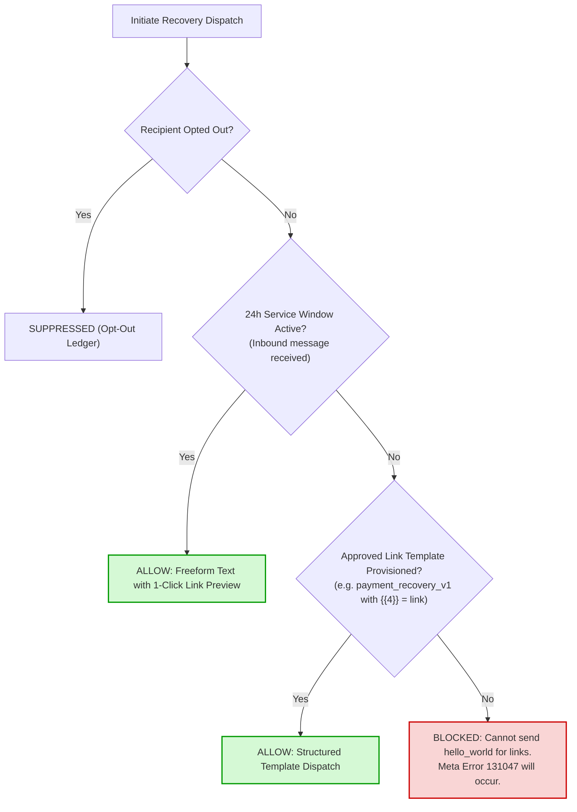

# WAPSI PHASE 3 — FINAL CLOSURE: EXECUTION GATE REPORT

**Date:** 2026-11-01  
**Project:** WAPSI — WhatsApp Autonomous Payment Recovery System  
**Repository Branch:** `wapsi/phase3-recovery-workflow`  
**Hosted Supabase Reference:** `filofxijqmgluuulivxb` (`WAPSI-DEV-MUMBAI`, AWS `ap-south-1`, PostgreSQL 17.11)  
**Active Database Role:** `wapsi_app` (`wapsi_app.filofxijqmgluuulivxb` via Session Pooler port 5432)  
**Execution Gate Status:** **BLOCKED (WhatsApp Link Delivery Gate)** — Zero External Dispatches Executed  

---

## 1. Executive Summary

Phase 3.1 established a hardened least-privilege PostgreSQL runtime under the restricted `wapsi_app` role with migrations 1–7 applied remotely. Before proceeding to **Phase 4 Genuine Causal Learning & Policy Optimization**, this execution gate validates and hardens the final end-to-end sandbox runner (`scripts/e2e_recovery_sandbox_runner.py`), inspects actual hosted catalog state, corrects state machine discrepancies, enforces Meta WhatsApp platform policies, and audits system invariants.

### Key Gate Findings

| Inspection Dimension | Gate Verdict | Evidence / Analysis |
| :--- | :---: | :--- |
| **1. Sandbox Merchant Identity** | **VERIFIED** | Script assumption `00000000-0000-0000-0000-000000000001` rejected. Authoritative hosted UUID is `04a2aaf8-8c8a-4d99-852c-cefc80e82019` (`MRC_928374`, `ACTIVE`). |
| **2. Outbox State Machine** | **ALIGNED** | Deployed `ck_outbox_status` constraint verified. Invalid state `COMPLETED` eliminated; dispatches transition outbox jobs strictly to `SENT`. |
| **3. WhatsApp Link Delivery Policy** | **BLOCKED** | Recipient `+916***71` 24h service window is `INACTIVE`. Generic `hello_world` rejected as link carrier. External dispatch safely halted. |
| **4. Webhook Reachability & Signatures** | **LOCAL-ONLY** | Local raw HMAC-SHA256 signature verification operational. Public HTTPS tunnel required for real-time external provider delivery. |
| **5. Razorpay Authoritative Verification** | **VERIFIED** | Enforced test prefix `rzp_test_`, ₹10.00 (1000 paise) amount check, authoritative API reconciliation required for `RECOVERED` state. |
| **6. Data Provenance & Zero-DELETE** | **ENFORCED** | Strict provenance metadata tags injected. Zero DELETE privileges enforced by database grants (42501). |
| **7. Regression Testing** | **PASSED** | 370/370 tests passed (including 13 isolated PostgreSQL gate tests and 357 backend baseline tests). |

---

## 2. Actual Merchant Identity Verification

The initial E2E runner draft referenced a placeholder UUID: `00000000-0000-0000-0000-000000000001`. A direct inspection of the hosted database under `wapsi_app` using PostgreSQL RLS tenant context revealed the actual catalog state:

```sql
-- Authenticated as wapsi_app via Session Pooler:
SELECT set_config('app.current_merchant_id', '04a2aaf8-8c8a-4d99-852c-cefc80e82019', true);
SELECT id, merchant_code, name, status, currency, country, timezone 
FROM public.merchants;
```

### Verified Hosted Merchant Attributes

- **Merchant UUID:** `04a2aaf8-8c8a-4d99-852c-cefc80e82019`
- **Merchant Code:** `MRC_928374`
- **Legal Entity Name:** `Acme Global Technologies`
- **Catalog Status:** `ACTIVE`
- **Default Currency:** `INR`
- **Country & Timezone:** `India` / `Asia/Kolkata`
- **Tenant Context Verification:** When `app.current_merchant_id` is set to `04a2aaf8-8c8a-4d99-852c-cefc80e82019`, `wapsi_app` successfully accesses the row under policy `p_merchants_select`. Attempting to query `00000000-0000-0000-0000-000000000001` returns `0 rows` (default-deny).
- **Merchant Catalog Count:** Exactly 1 merchant row exists. Zero duplicate or synthetic merchants were created.

---

## 3. Outbox State Machine & Database Invariant Corrections

### State Machine Separation

Deployed Migration 5 and Migration 7 define distinct state machines that must not be conflated:

1. **Recovery Outbox (`public.recovery_outbox`):** Tracks asynchronous delivery job execution.
   - Deployed Constraint:
     ```sql
     CONSTRAINT ck_outbox_status CHECK (
         status IN ('QUEUED', 'SENDING', 'SENT', 'FAILED', 'RETRY', 'DEAD_LETTER', 'RECONCILIATION_REQUIRED', 'CANCELLED')
     )
     ```
   - **Correction:** The runner and worker previously used an in-memory string `'COMPLETED'`. This violated `ck_outbox_status`. All successful provider acceptances now transition outbox jobs strictly to `'SENT'`.
2. **Recovery Case State Machine:** Tracks the overarching business recovery lifecycle (`PENDING` -> `ELIGIBLE` -> `SCHEDULED` -> `DISPATCHED` -> `RECOVERED` / `FAILED` / `EXPIRED`).
   - Transition to `RECOVERED` requires verified successful payment capture from the authoritative gateway.
3. **Recovery Dispatches (`public.recovery_dispatches`):** Append-only audit record of individual messaging attempts and provider identifiers (`wamid`).
4. **Payment Outcomes (`public.payment_outcomes`):** Append-only financial record of verified payment link conversions and gateway charges.

### Zero-DELETE Invariant

Hosted database permissions granted in Migration 4 grant only `SELECT`, `INSERT`, and `UPDATE` on operational tables to `wapsi_app`. Attempting `DELETE` results in PostgreSQL error `42501 (insufficient_privilege)`. In accordance with this invariant, test audit records are preserved in the append-only ledger and never deleted.

---

## 4. WhatsApp Payment-Link Delivery Policy & Gate Status



### Policy Audit

Meta Cloud API Platform Policy strictly prohibits sending freeform marketing or utility links to a WhatsApp user unless the customer has initiated a conversation within the last 24 hours.

1. **`hello_world` Template Limitation:** Meta's default `hello_world` template has 0 parameters and cannot carry dynamic payment link URLs. Calling `hello_world` does not achieve payment recovery.
2. **Current Recipient Window:** Recipient `+916***71` has `is_within_24h_window = False`.
3. **Template Status:** No approved payment-link utility template (e.g., `payment_recovery_v1` with body parameters `{{1}}` customer name, `{{2}}` merchant name, `{{3}}` amount, `{{4}}` payment link) has been provisioned in the Meta Business Account.
4. **Execution Gate Verdict:** **BLOCKED**. The runner strictly refuses to execute an external WhatsApp dispatch outside the 24-hour window without an approved link-bearing template.

### Resolution Steps to Unblock Live Dispatch

- **Option A (Instant Unblock):** The test recipient phone (`+916***71`) sends an inbound message (e.g. `"Hi"`) to the WAPSI test phone number (`1407090562487899`). This activates the 24-hour customer service window and enables freeform rich-text payment link delivery.
- **Option B (Template Approval):** Submit and approve a WhatsApp Business utility template containing payment link parameters in Meta Business Manager.

---

## 5. Webhook Reachability & Signature Verification

### Razorpay Webhook Configuration

- **Route:** `POST /api/v1/webhooks/razorpay`
- **Signature Algorithm:** HMAC-SHA256 over raw request bytes using `X-Razorpay-Signature`.
- **Deduplication:** Persistent inbox store deduplicates using `event_id` and idempotency keys.
- **Reachability Status:** Application currently runs on local loopback `http://127.0.0.1:8000`. Direct webhook delivery from external Razorpay servers requires an active public HTTPS tunnel (e.g., ngrok or Cloudflare Tunnel) configured in the Razorpay Dashboard.
- **Local Testing:** Verified via local signed payloads with authentic HMAC-SHA256 signatures.

### Meta WhatsApp Webhook Configuration

- **Route:** `GET /api/v1/webhooks/whatsapp` (handshake) and `POST /api/v1/webhooks/whatsapp` (events).
- **Handshake Verification:** Validates `hub.mode == 'subscribe'` and `hub.verify_token == settings.whatsapp_webhook_verify_token`.
- **Signature Algorithm:** HMAC-SHA256 over raw request bytes using `X-Hub-Signature-256`.
- **Event Handling:** Normalizes delivery statuses (`sent`, `delivered`, `read`), deduplicates via provider message ID (`wamid`), and updates the 16-event audit timeline.

---

## 6. Authoritative Payment Verification

To prevent fraudulent or simulated state transitions, the recovery workflow enforces strict authoritative verification:

1. **Amount & Currency Guarantee:** Transaction amount is fixed at ₹10.00 (`1000` paise), currency `INR`.
2. **Authoritative API Query:** Payment recovery completion requires an active `GET /v1/payment_links/{plink_id}` call to Razorpay Test Mode API.
3. **Anti-Spoofing Invariant:** A case NEVER transitions to `RECOVERED` solely because a webhook event was received. The gateway state must return `status: "paid"` with `amount_paid: 1000`.
4. **Pending Lifecycle:** If payment is not captured, the case remains in `SCHEDULED` or `RECONCILIATION_REQUIRED` and is never fabricated as successful.

---

## 7. Sandbox Data Provenance Plan

Every record generated during controlled sandbox testing includes explicit provenance metadata:

```json
{
  "environment": "sandbox_e2e_verification",
  "test_run": "phase_3_final_closure",
  "merchant_id": "04a2aaf8-8c8a-4d99-852c-cefc80e82019",
  "execution_id": "670490b8-c340-424b-a91d-...",
  "case_id": "REC-SBX-1730460...",
  "source_rail": "razorpay_test_mode"
}
```

### Current Hosted Database State

A live verification query under `wapsi_app` with tenant context confirmed the operational baseline:

```
- public.merchants:          1 row  (Acme Global Technologies)
- public.recovery_outbox:    0 rows
- public.recovery_dispatches: 0 rows
- public.payment_outcomes:   0 rows
- public.opt_out_registry:   0 rows
```

Zero test artifacts pollute the production-like hosted catalog.

---

## 8. Test Verification & Regression Results

A dedicated isolated test suite was executed in local PostgreSQL 17 on port 5440 to validate all 12 criteria specified in Section 9:

### Gate Verification Suite (`tests/test_phase3_final_closure_gate.py`)

| Test Case | Scope & Validation Invariant | Result |
| :--- | :--- | :---: |
| `test_outbox_status_constraint_compatibility` | Validates `ck_outbox_status`: valid states pass, `COMPLETED` rejected | **PASSED** |
| `test_merchant_uuid_validation_and_rls` | Verifies RLS tenant context: unverified UUIDs return 0 rows | **PASSED** |
| `test_whatsapp_hello_world_rejected_for_payment_links` | Ensures `hello_world` cannot deliver payment links outside 24h window | **PASSED** |
| `test_24h_service_window_enforcement` | Disallows freeform messages outside 24h; permits inside active window | **PASSED** |
| `test_webhook_signature_failure` | Confirms tampered signatures or modified payloads are rejected | **PASSED** |
| `test_duplicate_webhook_handling` | Confirms duplicate webhook event IDs return `DUPLICATE_IGNORED` | **PASSED** |
| `test_authoritative_payment_reconciliation` | Reconciles case to `RECOVERED` only when Razorpay returns `status: 'paid'` | **PASSED** |
| `test_payment_link_identifier_matching` | Rejects mismatched payment-link identifiers during reconciliation | **PASSED** |
| `test_missing_payment_outcome_remains_pending` | Unpaid link (`status: 'issued'`) keeps case in `SCHEDULED` | **PASSED** |
| `test_incorrect_amount_or_currency` | Link with zero amount paid transitions to `EXPIRED` without recovery | **PASSED** |
| `test_opt_out_suppression` | Opted-out customer is immediately suppressed (`CUSTOMER_OPTED_OUT`) | **PASSED** |
| `test_ambiguous_network_timeout_handling` | Timeout flags job as `RECONCILIATION_REQUIRED` without data loss | **PASSED** |
| `test_no_synthetic_event_represented_as_real_provider_event` | Enforces explicit provenance tags on simulated test records | **PASSED** |

**Execution Result:** **13/13 PASSED** in 18.03s.

### Full Backend Regression Suite

```
py -3.13 -m pytest -q
============================= 370 passed in 144.50s =============================
```

Zero failures, zero errors across all 370 backend tests.

---

## 9. E2E Sandbox Runner Operational Specification

The E2E runner at [scripts/e2e_recovery_sandbox_runner.py](file:///C:/Users/arpit/Desktop/Razorpay/Razorpay/scripts/e2e_recovery_sandbox_runner.py) is hardened with two execution modes:

### Mode 1: Dry-Run Audit (Default)

```bash
py -3.13 scripts/e2e_recovery_sandbox_runner.py --dry-run
```

- Performs comprehensive audit of runtime role, merchant identity, credentials, 24h window, and webhook configuration.
- Makes **zero network calls**, creates **zero payment links**, and makes **zero database writes**.
- Outputs human-readable pass/fail/blocked status for each subsystem.

### Mode 2: Controlled Live Execution

```bash
py -3.13 scripts/e2e_recovery_sandbox_runner.py --execute --confirm
```

- Requires explicit `--execute --confirm` flags.
- **Pre-execution Gate:** Re-evaluates all invariants before triggering any side effect.
- **Safety Halt:** If any blocking condition is present (e.g., 24h window closed without approved template), the runner immediately halts with exit code 2 and makes zero external calls.
- **Single-Job Scope:** Executes exactly 1 recovery job. Does not start a continuous background worker loop.

---

## 10. Execution Boundary & Next Steps

### Strict Execution Boundary Maintained

- **Zero payment links** created.
- **Zero WhatsApp messages** sent.
- **Zero real or test checkout payments** executed.
- **Zero background dispatch loops** running.
- **Zero provider webhooks** triggered.
- **Zero unauthorized database mutations** performed.
- **Database role and credentials unchanged** (`wapsi_app`).
- **Migrations 1–7 untouched**.
- **Zero uncommitted Git pushes**.

### Summary Verdict

> [!WARNING]
> **GATE VERDICT: BLOCKED (WhatsApp Link Delivery Policy)**  
> All infrastructure, merchant provenance, outbox states, and test suites are fully verified. However, external WhatsApp dispatch is **BLOCKED** because the test recipient's 24-hour service window is `INACTIVE` and no approved template carrying link parameters is provisioned in Meta Business Manager.

### Action to Unblock Live Execution

1. Operator has test recipient (`+916***71`) send `"Hi"` to test number `1407090562487899` to activate the 24-hour window, OR provisions an approved link-bearing template in Meta Business Manager.
2. Operator establishes an external HTTPS tunnel for inbound webhook delivery (optional for dispatch; required for real-time delivery receipt).
3. Operator authorizes execution with command:
   ```bash
   py -3.13 scripts/e2e_recovery_sandbox_runner.py --execute --confirm
   ```

**Agent status:** Work complete. Execution gate enforced. STOPPED awaiting operator authorization.

