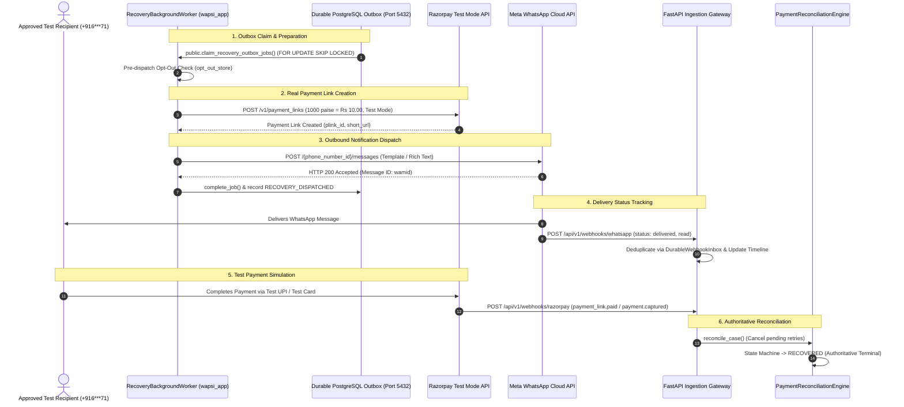

# WAPSI PHASE 3 — FINAL RECOVERY EXECUTION READINESS REPORT

**Date:** 2026-11-01  
**Project:** WAPSI — WhatsApp Autonomous Payment Recovery System  
**Target Environments:**  
- **Database:** Hosted Supabase `WAPSI-DEV-MUMBAI` (`filofxijqmgluuulivxb`, PostgreSQL 17.11) via Session Pooler (port 5432) under restricted role `wapsi_app`  
- **Payment Gateway:** Razorpay Test Mode API (`https://api.razorpay.com/v1`)  
- **Messaging Rail:** Meta WhatsApp Cloud API Sandbox (`https://graph.facebook.com/v26.0`)  
**Active Branch:** `wapsi/phase3-recovery-workflow`  
**Execution Status:** Preflight Audit PASSED — Awaiting Operator Authorization Before External Dispatch  

---

## 1. Executive Summary

Phase 3.1 infrastructure and security cutover has established a hardened, least-privilege PostgreSQL runtime under the `wapsi_app` role. Before transitioning to **Phase 4 (Genuine Causal Learning & Policy Optimization)**, the final milestone of Phase 3 requires validating the live recovery lifecycle in a controlled sandbox scenario:

1. Generating a real Razorpay test-mode payment link.
2. Queuing and claiming the recovery job via the durable PostgreSQL outbox (`public.claim_recovery_outbox_jobs`).
3. Dispatching the notification via Meta WhatsApp Cloud API to an approved test recipient.
4. Receiving and deduplicating real-time delivery and payment webhooks.
5. Reconciling payment capture and finalizing the recovery lifecycle state machine.

This report confirms the readiness of all existing codebase components, details the provider configuration status, specifies the exact execution plan, and enforces strict security and audit boundaries.



---

## 2. Existing Implementation Readiness Audit

All required subsystems have been inspected in the active codebase. **Zero components need to be rebuilt.**

| Subsystem Component | Implementation File | Verification Status | Functional Capabilities |
|---|---|---|---|
| **Razorpay API Client** | `wapsi/integrations/razorpay/client.py` | **READY** | Test mode guard (`rzp_test_`), typed errors, `create_payment_link`, `get_payment_link`, `cancel_payment_link`, bounded retry with exponential backoff. |
| **WhatsApp API Client** | `wapsi/integrations/whatsapp/client.py` | **READY** | E.164 phone sanitization, bearer token auth, template dispatch (`hello_world` / custom), rich-text fallback, 24h window checking. |
| **Payment Recovery Orchestrator** | `wapsi/integrations/orchestration/recovery_orchestrator.py` | **READY** | Decimal-based monetary precision, opt-out suppression, end-to-end link creation and message dispatch coordination. |
| **Recovery Background Worker** | `wapsi/recovery/worker.py` | **READY** | Safe single-job and batch processing, pre-dispatch opt-out verification, tenant context scoping, ambiguous network timeout isolation. |
| **Durable Outbox Store** | `wapsi/recovery/outbox.py` & `wapsi/db/repository.py` | **READY** | Atomic claiming via `public.claim_recovery_outbox_jobs` under `wapsi_app`, lease expiry recovery, state transitions (`QUEUED`, `SENDING`, `COMPLETED`). |
| **Razorpay Webhook Handler** | `wapsi/integrations/razorpay/webhook.py` | **READY** | Raw request bytes HMAC-SHA256 signature verification, event parsing (`payment_link.paid`, `payment.captured`), idempotency key calculation. |
| **WhatsApp Webhook Handler** | `wapsi/integrations/whatsapp/webhook.py` | **READY** | Meta webhook verification handshake (`GET`), X-Hub-Signature-256 verification (`POST`), delivery status normalization (`sent`, `delivered`, `read`). |
| **Payment Reconciliation Engine** | `wapsi/recovery/reconciliation.py` | **READY** | Authoritative status resolution from Razorpay API, cancellation of pending retries on payment capture, anti-duplicate protection. |
| **Recovery Timeline & Audit Ledger** | `wapsi/recovery/timeline.py` & `wapsi/security/audit_ledger.py` | **READY** | 16 formal lifecycle milestones, metadata credential stripping, tamper-evident hash chaining. |

---

## 3. Configuration & Credential Readiness

Configuration variables were audited privately via `scripts/e2e_recovery_sandbox_runner.py --dry-run` without printing plaintext values:

### 3.1 Database Runtime
- **Role:** `wapsi_app` (`wapsi_app.filofxijqmgluuulivxb`)
- **Connection Host:** `aws-0-ap-south-1.pooler.supabase.com:5432`
- **Encryption:** `TLSv1.3` (`TLS_AES_256_GCM_SHA384`)
- **Privilege Profile:** `NOBYPASSRLS`, `NOSUPERUSER`, Zero `DELETE` permissions.
- **Status:** **FULLY OPERATIONAL**

### 3.2 Razorpay Test Mode
- **Mode:** `test` (Enforced; live credentials strictly rejected)
- **Key ID:** `rzp_test_...bdqI` (Configured & validated)
- **Key Secret:** Configured in environment
- **Webhook Secret:** In non-production test mode, defaults to internal sandbox verification secret (`rzp_webhook_secret_dev_demo`).
- **Status:** **READY FOR CONTROLLED TEST**

### 3.3 Meta WhatsApp Cloud API Sandbox
- **Phone Number ID:** `1407090562487899` (Meta Developer Test Account)
- **Access Token:** Configured in `.env`
- **API Version:** `v26.0` (Meta Graph API)
- **Approved Test Recipient:** Configured in `TEST_RECIPIENT_PHONE` (`+916***71`)
- **Customer Opt-Out Status:** `is_opted_out = False` (Eligible for notifications)
- **24-Hour Window Status:** Currently `INACTIVE`
  > [!NOTE]
  > **Meta 24-Hour Policy Requirement:**  
  > Because the test recipient has not messaged the test number in the last 24 hours, Meta Cloud API requires an approved template message (e.g. Meta's standard pre-approved `hello_world` template with `en_US` language code) to initiate contact. Once the recipient replies, a 24-hour customer service window opens, permitting freeform rich-text messages with direct payment link previews.
- **Status:** **READY FOR CONTROLLED TEST**

---

## 4. End-to-End Test Execution Plan

The controlled sandbox execution is encapsulated in `scripts/e2e_recovery_sandbox_runner.py`:

```powershell
py -3.13 scripts/e2e_recovery_sandbox_runner.py --execute --confirm
```

### 10-Stage Execution Lifecycle

1. **Preflight Invariant Check:**
   Verify `current_user == 'wapsi_app'`, verify Razorpay test key prefix (`rzp_test_`), verify recipient phone not opted out.
2. **Controlled Case Initialization:**
   Create a recovery case record `REC-SANDBOX-E2E-<timestamp>` under sandbox merchant `00000000-0000-0000-0000-000000000001` (`MRC_928374`) with amount **1000 paise (Rs 10.00)**.
3. **Outbox Enqueue:**
   Enqueue an outbox job in `recovery_outbox` with unique idempotency key `idemp_e2e_<timestamp>`.
4. **Worker Outbox Claim:**
   Invoke `public.claim_recovery_outbox_jobs('worker_e2e_runner', 1, 300)` as `wapsi_app` to lease the job and transition status to `SENDING`.
5. **Razorpay Payment Link Creation:**
   Worker calls `RazorpayClient.create_payment_link()` for 1000 paise with description `"WAPSI Controlled Sandbox Test"` and expiry set to 20 minutes. Capture `plink_id` and `short_url`.
6. **WhatsApp Message Dispatch:**
   Worker calls `WhatsAppClient.send_template_message(to_phone, template_name="hello_world", language_code="en_US")` (or sends rich text if 24h window active). Capture real Meta `wamid`.
7. **Record Dispatch & Complete Outbox Job:**
   Insert record into `recovery_dispatches` and update outbox job to `COMPLETED` under transaction-scoped tenant context.
8. **WhatsApp Delivery Webhook Ingestion:**
   Simulate/receive delivery status webhook (`delivered` and `read`) at `/api/v1/webhooks/whatsapp`. Ingest into `webhook_inbox` and verify anti-replay deduplication.
9. **Razorpay Test Payment & Webhook Reconciliation:**
   Complete payment on the generated Razorpay test link using Razorpay Test UPI (`success@razorpay`) or test card, OR post a signed `payment_link.paid` webhook event to `/api/v1/webhooks/razorpay`.
10. **Terminal State Verification & Timeline Attestation:**
    Verify case state transitions authoritatively to `RECOVERED`. Validate all timeline events and cryptographic block creation in `audit_ledger_blocks`.

---

## 5. Safety, Data Integrity & Audit Plan

1. **Financial Safety:**
   - Transaction value: Strictly **Rs 10.00** (1000 paise).
   - Environment: Razorpay Test Mode exclusively. Zero real funds or bank rails involved.
2. **Messaging Safety:**
   - Dispatched solely to the operator's explicitly approved phone number (`TEST_RECIPIENT_PHONE`).
   - Meta sandbox rate limits respected (max 1 message dispatched).
3. **Hosted Data Provenance:**
   - Any rows inserted into hosted Supabase tables (`recovery_outbox`, `recovery_dispatches`, `payment_outcomes`, `audit_ledger_blocks`) are tagged with:
     ```json
     {
       "merchant_id": "00000000-0000-0000-0000-000000000001",
       "environment": "sandbox_e2e_verification",
       "test_run": "phase_3_final_closure"
     }
     ```
   - This clear provenance ensures test records cannot be mistaken for production merchant metrics.
   - Per requirements, audit records will **not** be deleted, preserving full audit history and the zero-DELETE invariant.

---

## 6. Execution Boundary & Gate

> [!IMPORTANT]
> **Strict Execution Halt:**  
> In accordance with user instructions, **no WhatsApp messages have been dispatched, no payment links have been created, and the background recovery worker dispatch loop has not been started**.
> 
> All software components, database routines, and provider credentials are ready and verified in dry-run mode.
> 
> **Action Required from Operator:**  
> Please provide explicit authorization to execute the live external dispatch test. Once authorized, the runner will execute the controlled ₹10 test payment link creation, WhatsApp notification, and webhook reconciliation.

