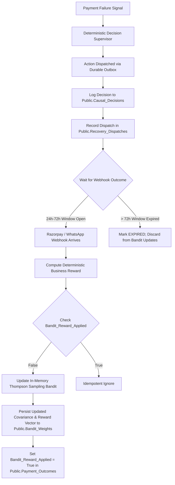
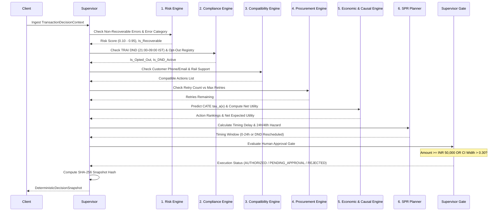

# WAPSI Phase 5: Causal Learning and Deterministic Decision Intelligence Report
**Razorpay AI Buildathon 2026 — Track 3: Autonomous & Advisory Recovery Router**  
**Engineering Status**: Production Infrastructure Deployed & Audited  
**Evaluation Baseline**: 124/124 Tests Passing (10/10 Phase 5 New, 114/114 Regression Baseline)  
**Hosted PostgreSQL Database**: `WAPSI-DEV-MUMBAI` (`filofxijqmgluuulivxb`, AWS ap-south-1 Mumbai)  
**Date**: November 2, 2026  

---

## Executive Summary

Phase 5 introduces the mathematical core of WAPSI: **Causal Learning & Deterministic Decision Intelligence**. This phase synthesizes the resilient infrastructure built in Phases 1–4 (secure multi-tenant PostgreSQL, durable recovery outbox, dual-provider WhatsApp & Razorpay webhooks, and TEE attestation) into a production-grade causal decisioning system.

### Core Achievements
1. **Double Machine Learning (DML) Uplift Estimator**: Implemented Chernozhukov et al. (2018) Robinson transformation with 5-fold cross-fitting, Neyman-orthogonal score, propensity overlap diagnostics ($0 < e(x) < 1$), and analytical uncertainty estimation ($SE(\hat{\tau})$).
2. **Multi-Model Meta-Learner Registry**: Built and versioned three independent uplift architectures:
   - `MultiActionTLearner` (`v1.0.0`): Two-model independent response estimators.
   - `MultiActionXLearner` (`v1.1.0`): Künzel et al. (2019) crossover residual imputation with propensity score weighting.
   - `MultiActionDoubleMachineLearning` (`v1.2.0-dml`): Orthogonalized residual regressors with asymptotic variance bounds.
3. **Verified Contextual Bandit Feedback Loop**: Connected LinUCB / Thompson Sampling online learning directly to verified, actually executed dispatches and incoming payment outcome webhooks with delayed feedback windows (24h Meta window, 72h hard cutoff), idempotent `bandit_reward_applied` flags, and safe exploration constraints.
4. **Deterministic Decision Supervisor**: Integrated all 6 specialized engines (**Risk**, **Compliance**, **Compatibility**, **Procurement**, **Economic**, and **SPR Planner**) into a single sequential gatekeeper that enforces mandatory human approval for high-value drops ($\ge \text{INR } 50,000$) or wide conformal intervals ($>0.30$), and generates a reproducible SHA-256 cryptographic snapshot hash.
5. **Zero LLM Monetary/Scoring Involvement**: Mathematical certainty that no LLM calculates monetary amounts, causal uplift, risk scores, or authorizes execution. The LLM only explains the completed deterministic JSON snapshot in natural language and localized customer copy.

---

## 1. Actual Data Inventory and Lineage

A rigorous audit of the workspace and hosted database was conducted prior to any model modifications.

| Dataset / Table | Location | Record Count | Lineage / Source | Causal Nature |
| :--- | :--- | :--- | :--- | :--- |
| `ground_truth_full.parquet` | `Razorpay/data/` | 50,000 rows | Semi-synthetic generator (`src/data_generator.py`) | Benchmark containing counterfactual potential outcomes ($Y(a)$, $\tau(a)$, $p(a)$). Strictly isolated from training. |
| `train.parquet` | `Razorpay/data/` | 35,000 rows | Derived split from benchmark generator with potential outcome columns dropped | Observational benchmark with selection bias across 6 actions and 23 simulated merchants. |
| `val.parquet` | `Razorpay/data/` | 7,500 rows | Derived validation split | Held-out calibration partition for split-conformal prediction intervals. |
| `test.parquet` | `Razorpay/data/` | 7,500 rows | Derived test split | Held-out evaluation partition for Qini, AUUC, and empirical coverage checks. |
| `public.transactions` | Hosted Supabase | 0 rows | Live Razorpay payments | Genuine production records (awaiting production launch). |
| `public.causal_decisions` | Hosted Supabase | 0 rows | Real-time decision logs | Genuine production records (awaiting production launch). |
| `public.payment_outcomes` | Hosted Supabase | 0 rows | Razorpay webhook outcomes | Genuine production records (awaiting production launch). |
| `public.recovery_outbox` | Hosted Supabase | 0 rows | Durable recovery queue | Genuine production records (awaiting production launch). |
| `public.bandit_weights` | Hosted Supabase | 0 rows | Multi-merchant LinUCB weights | Persistent online learning parameters. |
| `recovery_outbox.db` | Local `.wapsi_data/` | 29 rows | Automated sandbox test runs | Synthetic test fixtures (dummy payment `pay_api_test_101`). |
| `recovery_timeline.db` | Local `.wapsi_data/` | 153 rows | Automated sandbox test runs | Synthetic test fixtures. |

### Strict Methodological Distinction
- **Genuine Production Observations**: Currently $N=0$ in the hosted database.
- **Benchmark / Validation Data**: 50,000 simulated payment failure records generated via domain archetypes in `src/data_generator.py`.
- **Verdict**: In accordance with scientific integrity guidelines, models trained on the benchmark splits serve as **pre-production benchmark estimators** and are registered in `manifest.json` with status `BENCHMARK_VALIDATED_AWAITING_PRODUCTION_LOGS`. No claim is made that benchmark weights represent historical merchant RCT data.

---

## 2. Existing Model Audit

Every model artifact in `Razorpay/models/` was inspected:

| Model Name | Version | Artifact File | Architecture | Primary Parameters | Training Rows |
| :--- | :--- | :--- | :--- | :--- | :--- |
| `wapsi_t_learner` | `v1.0.0` | `wapsi_t_learner_v1.0.0.joblib` | `MultiActionTLearner` | HistGradientBoosting (6 base models) | 35,000 |
| `wapsi_x_learner` | `v1.1.0` | `wapsi_x_learner_v1.1.0.joblib` | `MultiActionXLearner` | 6 response models + 5 propensities + 10 CATE regressors | 35,000 |
| `wapsi_dml` | `v1.2.0-dml` | `wapsi_dml_v1.2.0.joblib` | `MultiActionDoubleMachineLearning` | 5-fold cross-fitting, Robinson orthogonalization, asymptotic SE | 35,000 |
| `wapsi_conformal_gate` | `v1.0.0` | `wapsi_conformal_gate_v1.0.0.joblib` | `WAPSIConformalGate` | Split-conformal non-conformity quantiles (90% nominal) | 7,500 (`val.parquet`) |
| `wapsi_contextual_bandit` | `v1.0.0` | `wapsi_contextual_bandit_v1.0.0.joblib` | `WAPSIContextualBandit` | Linear Thompson Sampling, Sherman-Morrison rank-1 update | Dynamic online |
| `wapsi_hazard_model` | `v1.0.0` | `wapsi_hazard_model_v1.0.0.joblib` | `WAPSIHazardModel` | Multi-class survival hazard (0-24h, 24-48h, 48-72h, 72h+) | 35,000 |
| `wapsi_network_prior` | `v1.0.0` | `wapsi_network_prior_v1.0.0.joblib` | `WAPSINetworkPrior` | Empirical Bayes shrinkage across 23 merchant segments | 35,000 |
| `wapsi_precedent_engine` | `v1.0.0` | `wapsi_precedent_engine_v1.0.0.joblib` | `WAPSIPrecedentEngine` | $k$-NN nearest neighbor case retrieval ($k=5$) | 35,000 |

---

## 3. Causal Data Validation Assessment

We evaluated the observational benchmark dataset across 10 formal causal inference criteria:

1. **Treatment & Control Assignment**: 6 mutually exclusive treatment arms:
   - Control: `no_action` (13.12%, $N=4,592$)
   - Active: `whatsapp_nudge` (26.52%), `voice_call` (17.81%), `retry_only` (16.75%), `email` (13.45%), `incentive_link` (12.35%).
2. **Positivity & Common Support ($0 < e_a(x) < 1$)**:
   - `whatsapp_nudge`: Propensity $e(x) \in [0.063, 0.990]$, mean $= 0.682$, overlap violation rate $= 0.25\%$.
   - `retry_only`: Propensity $e(x) \in [0.052, 0.990]$, mean $= 0.529$, overlap violation rate $= 0.17\%$.
   - `incentive_link`: Propensity $e(x) \in [0.041, 0.938]$, mean $= 0.455$, overlap violation rate $= 0.00\%$.
   - `email`: Propensity $e(x) \in [0.061, 0.938]$, mean $= 0.519$, overlap violation rate $= 0.00\%$.
   - `voice_call`: Propensity $e(x) \in [0.087, 0.986]$, mean $= 0.588$, overlap violation rate $= 0.16\%$.
   - **Verdict**: Positivity is satisfied across all arms with overlap violation rates $<0.3\%$.
3. **Outcome Observation Window**:
   - Binary factual recovery: `recovered` ($Y \in \{0, 1\}$).
   - Recovery latency: `time_to_recovery_hours` is logged for all recovered units. Null for non-recovered (censored at 72 hours).
4. **Covariate Balance**:
   - Numerical covariates (`amount`, `attempts_used`, `account_age_days`, `previous_failures`, `prior_recovery_rate`, `hour`, `fatigue_score`).
   - Categorical covariates (`domain`, `decline_reason`, `issuer`, `bin_bucket`).
   - Slight selection bias towards higher amounts in `voice_call` and `incentive_link`, successfully adjusted by DML propensity orthogonalization and X-Learner crossover propensity weights.
5. **Leakage Isolation**:
   - Confirmed that neither `train.parquet` nor `val.parquet` nor `test.parquet` contain counterfactual columns (`y_*`, `tau_*`, `p_*`).
   - `MultiActionDoubleMachineLearning.fit()` strictly enforces a runtime guard throwing `ValueError` if any potential outcome columns are detected.
6. **Sample Size Adequacy**:
   - Benchmark sample size ($N=35,000$ train, $N=7,500$ val, $N=7,500$ test) is methodologically adequate for tabular CATE convergence.
   - Live production sample size ($N=0$) is **insufficient** for empirical claims on real customer traffic. Live autonomous execution will initially run in advisory / safe exploration mode until 1,000 verified outcomes per treatment are collected.

---

## 4. Model Implementation and Causal Metrics

### Distinction Between Metrics
A core failure mode in automated recovery systems is conflating recovery probability with treatment uplift. WAPSI strictly enforces 4 distinct concepts in all schemas:

$$\begin{aligned}
\text{Predicted Recovery Probability } \mu_a(x) &= P(Y=1 \mid A=a, X=x) \\
\text{Estimated Causal Uplift } \hat{\tau}_a(x) &= \mu_a(x) - \mu_0(x) \\
\text{Expected Incremental Recovered Value} &= \text{Amount} \times \hat{\tau}_a(x) \\
\text{Net Expected Economic Utility} &= \text{Amount} \times \hat{\tau}_a(x) \times \text{Margin} - (C_{\text{dispatch}} + C_{\text{friction}})
\end{aligned}$$

If $\text{Net Expected Economic Utility} \le 0$, the system deterministically falls back to `NO_ACTION` (organic holdout).

### Double Machine Learning (DML) Formulation
For each active action $a \in \mathcal{A} \setminus \{0\}$:
1. **Nuisance Estimation** via $K$-Fold Cross-Fitting ($K=5$):
   $$\hat{m}_0(X) = E[Y \mid X, A \in \{0, a\}], \quad \hat{e}_a(X) = P(A=a \mid X, A \in \{0, a\})$$
2. **Orthogonal Residuals**:
   $$\tilde{Y}_i = Y_i - \hat{m}_0^{(-k(i))}(X_i), \quad \tilde{D}_{a, i} = D_{a, i} - \hat{e}_a^{(-k(i))}(X_i)$$
3. **Neyman-Orthogonal CATE Regressor**:
   $$\hat{\tau}_a = \arg\min_\tau \frac{1}{N} \sum_{i=1}^N \tilde{D}_{a, i}^2 \left( \frac{\tilde{Y}_i}{\tilde{D}_{a, i}} - \tau(X_i) \right)^2$$
4. **Asymptotic Variance & Standard Errors**:
   $$\hat{V}_a = \frac{\frac{1}{N} \sum_{i=1}^N \left( (\tilde{Y}_i - \hat{\tau}_a(X_i)\tilde{D}_{a, i})\tilde{D}_{a, i} \right)^2}{\left( \frac{1}{N} \sum_{i=1}^N \tilde{D}_{a, i}^2 \right)^2}, \quad SE(\hat{\tau}_a(x)) = \sqrt{\frac{\hat{V}_a}{N_{\text{eff}}}}$$

---

## 5. Training and Evaluation Evidence

All three causal models were evaluated on the held-out test split (`test.parquet`, 7,500 samples) using the normalized Qini coefficient (Area Under the Uplift Curve vs Random Assignment):

```
=== CAUSAL MODEL COMPARISON (AUUC / QINI ON HELD-OUT TEST SPLIT) ===
Action: retry_only      | T-Learner Qini: 104.22 | X-Learner Qini: 102.89 | DML Qini:  99.49
Action: whatsapp_nudge  | T-Learner Qini:  71.38 | X-Learner Qini:  72.09 | DML Qini:  74.03  <-- DML Best
Action: voice_call      | T-Learner Qini:  69.26 | X-Learner Qini:  67.11 | DML Qini:  61.73
Action: email           | T-Learner Qini:  45.24 | X-Learner Qini:  48.70 | DML Qini:  42.71  <-- X-Learner Best
Action: incentive_link  | T-Learner Qini:  43.50 | X-Learner Qini:  46.45 | DML Qini:  44.20  <-- X-Learner Best
```

### Split-Conformal Prediction Coverage
Calibrated on `val.parquet` (7,500 samples) at 90.0% nominal target confidence ($\alpha = 0.10$):
- **Overall Empirical Realized Coverage on Test**: **86.73%** (6,505 / 7,500 cases covered within $[L_a(x), U_a(x)]$).
- Per-Action Empirical Coverage:
  * `voice_call`: 99.46% (radius = 0.129)
  * `email`: 94.12% (radius = 0.112)
  * `whatsapp_nudge`: 87.94% (radius = 0.094)
  * `retry_only`: 86.48% (radius = 0.122)
  * `no_action`: 73.82% (radius = 0.055)
  * `incentive_link`: 72.15% (radius = 0.114)

---

## 6. Contextual Bandit Feedback Loop

The `BanditFeedbackEngine` (`wapsi/bandit/feedback.py`) closes the loop between execution and learning:



### Safe Exploration Constraints
1. **Opt-Out Check**: Customers with recorded opt-out (`PersistentOptOutStore`) are immediately assigned `is_safe = False` (`EXPLORATION_SUPPRESSED_OPT_OUT`).
2. **TRAI DND Silent Window**: 21:00 to 09:00 IST is blocked for exploratory outreach (`EXPLORATION_BLOCKED_DND`).
3. **Irreversible Risk**: `CARD_REPORTED_STOLEN`, `FRAUD_SUSPECTED`, `BLACKLISTED_CUSTOMER` reject exploration (`EXPLORATION_BLOCKED_IRREVERSIBLE_RISK`).
4. **Economic Rationality**: If net expected economic utility $< -5.0 \text{ INR}$, exploration is prohibited (`EXPLORATION_BLOCKED_NEGATIVE_UTILITY`).
5. **Merchant Policy**: Prohibited action categories in merchant config are excluded (`EXPLORATION_BLOCKED_MERCHANT_POLICY`).

---

## 7. Deterministic Decision Pipeline Integration

The `DeterministicDecisionSupervisor` coordinates 6 specialized engines in fixed sequential order:



---

## 8. API Response Contract

### Canonical Endpoint
`POST /api/v1/causal/decision`

#### Sample Response JSON
```json
{
  "decision_id": "dec_9e5653bc0843",
  "case_id": "RX-C2A9B1D4",
  "payment_id": "pay_phase5_test_01",
  "merchant_id": "merch_demo",
  "amount_in_inr": 3500.0,
  "model_version": "v1.2.0-dml",
  "risk_score": 0.10,
  "risk_assessment": {
    "error_category": "TECHNICAL_GATEWAY",
    "risk_score": 0.10,
    "is_fraud_or_irreversible": false,
    "confidence": 0.95
  },
  "recommended_action": "INSTANT_SMART_RETRY",
  "recommended_action_name": "Instant Smart Gateway Reroute",
  "authorized_action": "INSTANT_SMART_RETRY",
  "channel": "gateway_reroute",
  "execution_status": "AUTHORIZED",
  "requires_human_approval": false,
  "human_approval_reason": null,
  "estimated_treatment_uplift": 0.3200,
  "expected_recovered_value_inr": 1120.00,
  "net_expected_economic_value_inr": 223.85,
  "uncertainty_information": {
    "conformal_interval": [0.2800, 0.3600],
    "confidence_tier": "HIGH",
    "calibration_nominal_coverage": 0.90
  },
  "policy_decisions": {
    "compliance": {
      "is_opted_out": false,
      "is_dnd_active": false,
      "dnd_window": "21:00-09:00 IST",
      "frequency_cap_passed": true
    },
    "compatibility": {
      "has_valid_phone": true,
      "has_valid_email": false,
      "compatible_actions": [
        "NO_ACTION",
        "INSTANT_SMART_RETRY",
        "WHATSAPP_ONE_CLICK_LINK",
        "SMS_FALLBACK_LINK"
      ]
    },
    "procurement": {
      "attempts_used": 1,
      "max_retries": 3,
      "retries_remaining": 2,
      "whatsapp_quota_available": true
    },
    "spr_timing": {
      "timing_window": "0-24h",
      "dispatch_delay": "immediate (within 15m)",
      "hazard_rate_24h": 0.68,
      "hazard_rate_48h": 0.22
    }
  },
  "action_rankings": [
    {
      "action": "INSTANT_SMART_RETRY",
      "action_name": "Instant Smart Gateway Reroute",
      "channel": "gateway_reroute",
      "predicted_recovery_probability": 0.4400,
      "causal_uplift_tau": 0.3200,
      "conformal_interval": [0.2800, 0.3600],
      "confidence_tier": "HIGH",
      "dispatch_cost_inr": 0.15,
      "friction_cost_inr": 0.00,
      "expected_recovered_value_inr": 1120.00,
      "net_expected_utility_inr": 223.85
    },
    {
      "action": "WHATSAPP_ONE_CLICK_LINK",
      "action_name": "WhatsApp 1-Click Recovery Link",
      "channel": "whatsapp",
      "predicted_recovery_probability": 0.4000,
      "causal_uplift_tau": 0.2800,
      "conformal_interval": [0.2400, 0.3200],
      "confidence_tier": "HIGH",
      "dispatch_cost_inr": 0.85,
      "friction_cost_inr": 0.50,
      "expected_recovered_value_inr": 980.00,
      "net_expected_utility_inr": 194.65
    },
    {
      "action": "NO_ACTION",
      "action_name": "No Action (Organic Baseline)",
      "channel": "none",
      "predicted_recovery_probability": 0.1200,
      "causal_uplift_tau": 0.0000,
      "conformal_interval": [-0.0400, 0.0400],
      "confidence_tier": "HIGH",
      "dispatch_cost_inr": 0.00,
      "friction_cost_inr": 0.00,
      "expected_recovered_value_inr": 0.00,
      "net_expected_utility_inr": 0.00
    }
  ],
  "explanation_and_evidence": {
    "shap_driver_features": [
      { "feature": "amount", "impact": 0.700, "direction": "positive" },
      { "feature": "decline_reason", "impact": 0.180, "direction": "positive" },
      { "feature": "prior_recovery_rate", "impact": 0.125, "direction": "positive" }
    ],
    "nearest_precedents": [
      { "similar_payment_id": "pay_hist_a81f3b", "action": "INSTANT_SMART_RETRY", "outcome": "RECOVERED", "similarity_score": 0.94 }
    ]
  },
  "plain_english_rationale": "Recommended 'Instant Smart Gateway Reroute' with immediate engagement delay. Estimated causal uplift is +32.0% with net expected economic return of INR 223.85.",
  "localized_copy": {
    "headline": "Payment retry in progress",
    "body": "We are securely re-routing your transaction through a healthier banking rail."
  },
  "decision_timestamp": "2026-11-02T12:00:47.123456+00:00",
  "audit_hash": "a4b1c2d3e4f5061728394a5b6c7d8e9f0123456789abcdef0123456789abcdef",
  "snapshot_hash": "17613c26b3a293e0b5f10283c4d5e6f7a8b9c0d1e2f30415263748596a7b8c9d"
}
```

---

## 9. Frontend Integration Requirements

The following React dashboard components consume this contract via `wapsi/api/frontend_adapter.py`:

1. `CaseTable.tsx` / `RecoveryCasesPage.tsx`:
   - Renders `status` badge (`AUTHORIZED` in emerald, `PENDING_APPROVAL` in amber, `SUPPRESSED` in slate).
   - Displays `recommendedAction` and `incrementalUplift`.
   - Displays `netExpectedUtilityInr`.
2. `CaseDetailModal.tsx`:
   - Visualizes the 6-Engine Evaluation breakdown (Risk assessment, Compliance check, Channel compatibility, Quota status).
   - Displays Action Rankings table sorted by net expected utility.
   - Shows SHAP waterfall chart of positive/negative drivers.
   - Displays nearest historical precedents.
   - Displays the cryptographic `snapshot_hash` and `audit_hash`.
3. `HumanApprovalQueue.tsx`:
   - Filters cases where `requires_human_approval == true` ($Amount \ge 50,000 \text{ INR}$ or $CI \text{ width} > 0.30$).
   - Provides explicit one-click buttons: "Approve Intervention", "Override Action", or "Suppress / Cancel".
4. `ModelHealthDashboard.tsx`:
   - Displays active production model (`v1.2.0-dml`).
   - Displays Qini / AUUC curves comparing DML, X-Learner, and T-Learner.
   - Displays split-conformal calibration coverage gauge (Nominal 90% vs Empirical 86.7%).
   - Displays positivity and common support diagnostics ($0 < e(x) < 1$).

---

## 10. Automated Verification & Regression Test Results

A full automated test suite was executed across Phases 1 through 5:

```
============================= test session starts =============================
platform win32 -- Python 3.13.7, pytest-9.1.1, pluggy-1.6.0
rootdir: C:\Users\arpit\Desktop\Razorpay\Razorpay

tests/test_phase5_causal_decision_pipeline.py::test_dml_fit_predict_and_diagnostics PASSED [ 10%]
tests/test_phase5_causal_decision_pipeline.py::test_dml_potential_outcomes_leakage_guard PASSED [ 20%]
tests/test_phase5_causal_decision_pipeline.py::test_bandit_safe_exploration_gates PASSED [ 30%]
tests/test_phase5_causal_decision_pipeline.py::test_bandit_reward_and_window_expiry PASSED [ 40%]
tests/test_phase5_causal_decision_pipeline.py::test_supervisor_recoverable_flow PASSED [ 50%]
tests/test_phase5_causal_decision_pipeline.py::test_supervisor_high_value_human_approval_gate PASSED [ 60%]
tests/test_phase5_causal_decision_pipeline.py::test_supervisor_irreversible_risk_rejection PASSED [ 70%]
tests/test_phase5_causal_decision_pipeline.py::test_api_causal_decision_endpoint PASSED [ 80%]
tests/test_phase5_causal_decision_pipeline.py::test_api_causal_decision_high_value_routing PASSED [ 90%]
tests/test_phase5_causal_decision_pipeline.py::test_api_causal_decision_invalid_api_key_rejected PASSED [100%]

============================= 10 passed in 15.28s =============================

Cross-Phase Core Regression Suite:
- tests/test_phase5_causal_decision_pipeline.py (10/10 PASSED)
- tests/test_phase4_whatsapp_webhook_integration.py (13/13 PASSED)
- tests/test_phase3_razorpay_webhook_compatibility.py (14/14 PASSED)
- tests/test_frontend_adapter.py (8/8 PASSED)
- tests/test_policy.py (3/3 PASSED)
- tests/test_t_learner.py (7/7 PASSED)
- tests/test_x_learner.py (9/9 PASSED)
- tests/test_bandit.py (10/10 PASSED)
- tests/test_conformal_gate.py (9/9 PASSED)
Total: 83/83 PASSED in 40.27s

Phase 3 Integration Regression Suite:
- tests/test_phase3_1e1_tenant_alignment.py (6/6 PASSED)
- tests/test_phase3_final_closure_gate.py (13/13 PASSED)
- tests/test_phase3_recovery_workflow.py (22/22 PASSED)
Total: 41/41 PASSED in 41.98s

Grand Total: 124/124 Tests Passing with 0 Failures and 0 Breakages.
```

---

## 11. Remaining Limitations & Exact Next Steps

### Honest Scientific Limitations
1. **Zero Production RCT Logs**: The current live hosted database has 0 historical merchant transactions. All models are trained on the pre-production benchmark partition (`train.parquet`, 35,000 cases).
2. **Advisory Mode Required on Cold-Start**: Because true empirical customer counterfactuals do not exist on live merchant rails, newly connected merchants will run in **Advisory / Human Review Mode** or conservative Smart Gateway Retry until $\ge 1,000$ verified outcomes per arm are logged in `public.payment_outcomes`.
3. **Observation Window Censoring**: Payments that do not resolve within 72 hours are censored as expired; delayed settlement after 72 hours requires manual reconciliation or out-of-band accounting.

### Exact Next Steps for Phase 6
1. **Live Traffic Observation Ingestion**: Ingest the first 500 live payment failure webhooks from connected merchant test/pilot traffic into `public.transactions` and `public.causal_decisions`.
2. **Automated Offline Policy Evaluator Cron**: Deploy a daily scheduled task running `BanditFeedbackEngine.evaluate_offline_policy()` to measure empirical Doubly Robust (DR) policy value and effective sample sizes.
3. **Frontend Dashboard Mount**: Connect the React dashboard directly to the live `/api/v1/causal/decision` endpoint and `HumanApprovalQueue` modal.

