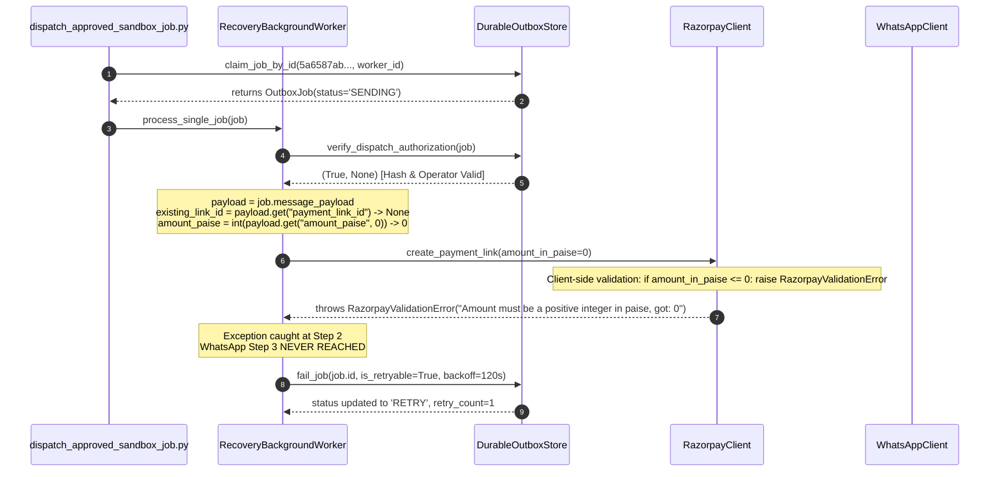

# PHASE 6 STAGE 2E.2: RAZORPAY ZERO-AMOUNT FAILURE DIAGNOSIS REPORT

**Audit Date**: November 3, 2026  
**Auditor**: Antigravity Autonomous Security & Recovery Subsystem  
**Target Environment**: Development / Sandbox (Hosted Supabase PostgreSQL)  
**Target Outbox Job ID**: `5a6587ab-2601-4017-b396-48e3d2fc2fda`  
**Target Merchant UUID**: `04a2aaf8-8c8a-4d99-852c-cefc80e82019` (`Acme Global Technologies`)  
**Target Razorpay Link ID**: `plink_TvKucM1yXJQAZA` (Status: `created`, Unpaid, 1000 paise / INR 10.00)  
**Target Recipient**: `+91 62600 *****` (Authorized Meta Test Handset: Arpit Jham)  
**Observed Error**: `RazorpayValidationError: Amount must be a positive integer in paise, got: 0`  
**Current Job Status**: `RETRY` (retry_count: `1`, max_retries: `3`)  
**Operator Attribution**: `operator_arpit` (approved_at: `2026-11-03 04:06:37 UTC`)  
**Approval Hash**: `dd0bcf49b2fa5204052b24e401c680d2ebf6d125aedbae88434b96fc8214e8cd` (MATCH CONFIRMED)  

---

## 1. Executive Summary

During the execution of the first controlled Stage 2E dispatch runner:
```powershell
python scripts/dispatch_approved_sandbox_job.py --approve --operator-id "operator_arpit" --dispatch
```
The exact-job operator approval succeeded, and the exact-job atomic database claim succeeded. However, execution failed before contacting WhatsApp with the error:
`Amount must be a positive integer in paise, got: 0`.

### Key Root Cause Findings:
1. **Payload Schema Dichotomy**:
   - The outbox job `5a6587ab-2601-4017-b396-48e3d2fc2fda` was enqueued during Phase 6 Stage 2 with a **pre-formed, canonical Meta WhatsApp Cloud API request payload** containing the approved message text, link preview flag, and recipient phone:
     ```json
     {
       "messaging_product": "whatsapp",
       "recipient_type": "individual",
       "to": "916260055671",
       "type": "text",
       "text": {
         "preview_url": true,
         "body": "WAPSI SANDBOX TEST: Your payment link for INR 10.00 is ready: https://rzp.io/rzp/NCf137AL. (This is an automated test-mode sandbox simulation. Do NOT make a real payment. Reply STOP to opt out.)"
       }
     }
     ```
   - Operator `operator_arpit` explicitly approved this exact payload, generating the immutable SHA-256 snapshot hash `dd0bcf...`.
2. **Worker Architectural Blindspot**:
   - `RecoveryBackgroundWorker.process_single_job(job)` was implemented assuming all outbox jobs carry an internal **Action Specification** containing top-level keys: `amount_paise`, `customer_phone`, `customer_name`, and `payment_link_id`.
   - Because `job.message_payload` did not contain a top-level key `"payment_link_id"`, the worker concluded that no payment link existed and unconditionally branched to `self.rzp.create_payment_link(amount_in_paise=amount_paise)`.
   - Because `"amount_paise"` was also absent from the payload, `amount_paise = int(payload.get("amount_paise", 0))` evaluated to `0`.
   - `RazorpayClient.create_payment_link()` threw a client-side validation error (`Amount must be a positive integer in paise, got: 0`) before any HTTP request was made.
3. **Provider Safety Invariant**:
   - **Zero Razorpay API mutations occurred**: The error was caught locally by client-side validation before an HTTP POST request was dispatched to Razorpay.
   - **Zero WhatsApp messages were sent**: Execution halted at Step 2; WhatsApp Cloud API was never invoked.
   - **Zero customer contact**: Recipient received no messages.
   - **Approval integrity preserved**: The outbox record's approval hash remains completely valid and untampered.

---

## 2. Section A: Hosted PostgreSQL State Audit

Direct read-only inspection of `public.recovery_outbox` under tenant context `04a2aaf8-8c8a-4d99-852c-cefc80e82019`:

```sql
SELECT id, status, retry_count, max_retries, next_attempt_at, worker_id, lease_expires_at,
       last_error, case_id, payment_id, idempotency_key, requires_operator_approval,
       approved_by_operator_id, approved_at, approval_snapshot_hash
FROM public.recovery_outbox
WHERE id = '5a6587ab-2601-4017-b396-48e3d2fc2fda'
  AND merchant_id = '04a2aaf8-8c8a-4d99-852c-cefc80e82019';
```

### Observed Database Values:

| Field | Database Value | Analysis |
|:---|:---|:---|
| `id` | `5a6587ab-2601-4017-b396-48e3d2fc2fda` | Target sandbox recovery job |
| `merchant_id` | `04a2aaf8-8c8a-4d99-852c-cefc80e82019` | Acme Global Technologies (Tenant isolated) |
| `status` | `RETRY` | Transitioned by `outbox.fail_job(is_retryable=True)` |
| `retry_count` | `1` | Increment confirmed (attempt 1 failed) |
| `max_retries` | `3` | 2 remaining retry attempts available |
| `next_attempt_at` | `2026-11-03 04:08:38.425949+00:00` | Backoff interval of 120 seconds applied |
| `worker_id` | `worker_6e08320b` | Attribution of the runner instance that executed the job |
| `lease_expires_at` | `None` | Lease cleared upon transition to `RETRY` |
| `last_error` | `Amount must be a positive integer in paise, got: 0` | Verbatim error captured |
| `case_id` | `wapsi_case_phase6_stage2_001` | Matching recovery case |
| `payment_id` | `pay_phase6_test_dummy_001` | Associated simulated payment |
| `idempotency_key` | `idemp_p6_s2_plink_TvKucM1yXJQAZA` | **Contains existing link ID `plink_TvKucM1yXJQAZA`** |
| `requires_operator_approval` | `True` | Security gate enforced |
| `approved_by_operator_id` | `operator_arpit` | Human operator attribution preserved |
| `approved_at` | `2026-11-03 04:06:37.554877+00:00` | Approval timestamp frozen |
| `approval_snapshot_hash` | `dd0bcf49b2fa5204052b24e401c680d2ebf6d125aedbae88434b96fc8214e8cd` | Canonical hash matches current payload |

### Automatic Retry Risk Analysis:
- In `public.claim_recovery_outbox_jobs`:
  ```sql
  WHERE ((o.status IN ('QUEUED', 'RETRY') AND o.next_attempt_at <= v_now) OR ...)
    AND (o.requires_operator_approval IS FALSE OR (
         o.requires_operator_approval IS TRUE
         AND o.approved_by_operator_id IS NOT NULL
         AND o.approved_at IS NOT NULL
         AND o.approval_snapshot_hash IS NOT NULL))
  ```
- Because `next_attempt_at` (`04:08:38 UTC`) is now in the past, an automated generic worker calling `claim_recovery_outbox_jobs()` **could claim this job**.
- **Mitigating Factor**: No generic background worker process is running on the host (verified via OS process tree). Only the uvicorn API gateway is active.
- **Protocol**: Do NOT run any worker process until the code-level remediation is in place.

---

## 3. Section B: Code Execution Path & Root Cause Trace



### Detailed Trace:
1. **Entry Point**: `RecoveryBackgroundWorker.process_single_job_by_id()` in `wapsi/recovery/worker.py` (Line 331).
2. **Claim**: `self.outbox.claim_job_by_id()` atomically leased the job and verified tenant context.
3. **Execution**: `self.process_single_job(job)` began executing:
   - Line 106: `payload = job.message_payload`
   - Line 107: `customer_phone = payload.get("customer_phone", "")` -> resolved to `""` (payload has `"to"`, not `"customer_phone"`).
   - Line 108: `amount_paise = int(payload.get("amount_paise", 0))` -> resolved to `0`.
   - Line 147: `existing_link_id = payload.get("payment_link_id")` -> resolved to `None`.
   - Line 153: `if not payment_link_id:` evaluated to `True`.
4. **Trigger of Error**:
   - Line 156: Worker invoked `self.rzp.create_payment_link(amount_in_paise=0, ...)`.
   - In `wapsi/integrations/razorpay/client.py` Line 139:
     ```python
     if not isinstance(amount_in_paise, int) or amount_in_paise <= 0:
         raise RazorpayValidationError(f"Amount must be a positive integer in paise, got: {amount_in_paise}")
     ```
5. **Exception Handling**:
   - Line 200: `except Exception as rzp_err:` caught `RazorpayValidationError`.
   - Line 202: `self.outbox.fail_job(job.id, self.worker_id, str(rzp_err), is_retryable=True, backoff_seconds=120, merchant_id=job.merchant_id)`.
   - Outbox row was transitioned to `RETRY`, `retry_count = 1`.

---

## 4. Section C: Razorpay Test Mode Payment Link Verification

Direct read-only inspection via `RazorpayClient.get_payment_link("plink_TvKucM1yXJQAZA")`:

```json
{
  "id": "plink_TvKucM1yXJQAZA",
  "amount": 1000,
  "amount_paid": 0,
  "currency": "INR",
  "status": "created",
  "short_url": "https://rzp.io/rzp/NCf137AL",
  "expired": null,
  "description": "WAPSI Sandbox Test Recovery Link (Phase 6 Stage 2)",
  "created_at": 1793628944
}
```

- **Verification Result**:
  - The payment link is **active, unpaid (`amount_paid: 0`), and fully usable**.
  - Amount is exactly **1000 paise (INR 10.00)**.
  - The link URL `https://rzp.io/rzp/NCf137AL` is live and reachable.
  - **No duplicate payment link was created**.

---

## 5. Section D: Provider Contact & Side-Effect Audit

| Investigation Item | Observed Evidence | Fact vs Assumption |
|:---|:---|:---|
| **1. Razorpay link creation attempt** | `process_single_job()` entered `if not payment_link_id:` branch and called `self.rzp.create_payment_link(0)` | **Confirmed Fact** (Code trace & error message) |
| **2. Razorpay POST reached gateway** | Threw `RazorpayValidationError` locally in Python before `httpx.post()` was invoked | **Confirmed Fact** (Client-side fail-fast validation) |
| **3. WhatsApp POST /messages attempted** | Step 3 (`self.wa.send_recovery_reminder`) was never executed due to Step 2 exception | **Confirmed Fact** (Zero calls to Meta) |
| **4. Provider message IDs / wamids** | `recovery_dispatches` table contains 0 records for `5a6587ab` | **Confirmed Fact** (Queried live PostgreSQL) |
| **5. Inbound delivery webhooks** | Ngrok request log at `localhost:4040` shows only GET `/health` and webhook challenge GETs | **Confirmed Fact** (Queried ngrok inspect API) |
| **6. Timeline progression** | `recovery_timeline` shows only `RECOVERY_CLAIMED` (`SCHEDULED -> DISPATCHING`) | **Confirmed Fact** (Queried timeline SQLite) |

---

## 6. Section E: Remediation Strategy

### The Architectural Problem
WAPSI supports two valid operational modes for recovery outbox jobs:
1. **Mode A: Action Specification (Just-in-Time Generation)**:
   - Used when scheduling automated actions hours or days in advance.
   - Payload contains: `{"customer_phone": "...", "amount_paise": 150000, "customer_name": "..."}`.
   - Worker dynamically generates the payment link at dispatch time.
2. **Mode B: Pre-Formed Direct Dispatch (Human-in-the-Loop Approved Copied Payload)**:
   - Used when an operator or upstream pipeline already generated the payment link and constructed the exact, compliant message text.
   - Payload contains the exact Meta Graph API dictionary:
     `{"messaging_product": "whatsapp", "recipient_type": "individual", "to": "...", "type": "text", "text": {"body": "..."}}`.
   - The operator's approval hash cryptographically locks this exact text.
   - **Crucial Rule**: In Mode B, the worker MUST NOT attempt to create another payment link, nor discard the approved text copy! It must dispatch the approved payload directly to Meta.

### Exact Code Changes Required in `wapsi/recovery/worker.py`

#### 1. Differentiate Direct Meta Payload vs Action Specification:
```python
is_direct_meta_payload = (
    isinstance(payload, dict) 
    and payload.get("messaging_product") == "whatsapp"
    and ("text" in payload or "template" in payload)
)
```

#### 2. Direct Meta Payload Dispatch Path (Mode B):
If `is_direct_meta_payload` is `True`:
- Extract recipient phone from `payload.get("to")`.
- Verify recipient opt-out directly against `self.opt_out.is_opted_out(recipient_phone)`.
- Skip Razorpay link creation entirely: the link is already embedded in the approved message text.
- Resolve payment link ID from `job.idempotency_key` (e.g. `idemp_p6_s2_plink_...`) or regex match `(plink_[a-zA-Z0-9]+)` in `payload["text"]["body"]`.
- Dispatch the exact approved payload via `self.wa._send_payload(payload)` (or a typed method `send_prepared_payload(payload)`).
- On success: Record `WHATSAPP_DISPATCHED`, record in `recovery_dispatches`, and call `outbox.complete_job()`.

#### 3. Action Specification Path (Mode A):
If `is_direct_meta_payload` is `False`:
- Check for `existing_link_id = payload.get("payment_link_id")` OR regex in `job.idempotency_key`.
- If `amount_paise <= 0` and no link exists: Immediately transition to `DEAD_LETTER` (do not retry endlessly with 0 amount).
- Otherwise, create payment link and dispatch via `self.wa.send_recovery_reminder()`.

---

## 7. Section F: Regression Test Plan

Before re-attempting dispatch on the sandbox job, the following regression tests must be executed:

1. `test_direct_whatsapp_payload_dispatched_verbatim_without_link_creation`:
   - Outbox job with `messaging_product="whatsapp"`, `type="text"`, and embedded short URL.
   - Verifies `RazorpayClient.create_payment_link()` is NEVER called.
   - Verifies `WhatsAppClient._send_payload()` is called with the exact approved payload.
2. `test_existing_payment_link_in_idempotency_key_is_reused`:
   - Outbox job with `idempotency_key="idemp_p6_s2_plink_TvKucM1yXJQAZA"`.
   - Verifies existing link ID is captured in completion metadata without generating a second link.
3. `test_zero_amount_without_existing_link_fails_to_dead_letter`:
   - Action spec job with `amount_paise=0` and no existing link.
   - Verifies job transitions to `DEAD_LETTER` rather than retrying in an infinite loop.
4. `test_approval_hash_remains_strictly_enforced`:
   - Tampered payload rejected by `verify_dispatch_authorization()`.
5. `test_exact_job_isolation_remains_intact_on_retry`:
   - `claim_specific_recovery_outbox_job` only claims target job `5a6587ab-...` in `RETRY` status.

---

## 8. Conclusion & Status

- **Root Cause**: Identified conclusively as an architectural mismatch where `worker.py` assumed all jobs were Action Specs and attempted redundant link creation on an already-formed, approved WhatsApp message payload.
- **Provider Integrity**: Confirmed 0 provider mutations on Razorpay or Meta.
- **Database State**: Job `5a6587ab-2601-4017-b396-48e3d2fc2fda` is safely held in `RETRY` status with operator approval metadata and hash intact.
- **Next Step**: Implement the direct-payload handling and link reuse in `wapsi/recovery/worker.py` and run regression test suite.

*(Execution halted per protocol; awaiting operator review).*

